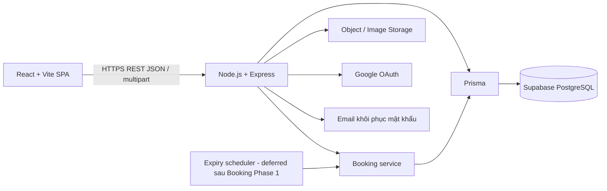

# System Architecture

## Stabilization baseline — 2026-10-07

Frontend dùng API client, Auth Context, AccessibleModal, OwnerLayout và response validators dùng chung; nhãn trạng thái được chia theo domain Booking/Facility. Không có design system hoặc validation framework mới. Read models aggregate hiện tại giữ query budget Public List 2, Detail 2, Availability 3 và Owner Booking 6; Owner Booking là fixed fan-out, không phải N+1. RTT/cold connection/cache/hosting được hoãn đến lúc deploy thật.

## Performance read-model strategy — 2026-10-07

Local backend truy cập Supabase Session Pooler ở region xa với RTT khoảng 300 ms cho mỗi PostgreSQL statement; query planning/execution của dữ liệu demo dưới 1 ms nên số round-trip là nút thắt chính. Các read model Public Facility List, Public Facility Detail, Availability và Owner Booking List dùng SQL tham số hóa với tập cột cố định và JSON aggregation nhỏ để tránh Prisma relation fan-out. Không dùng `SELECT *`, sort/filter vẫn là whitelist từ validation hiện có, và DTO mapper không trả storage identifier hay field riêng tư.

Public List/Detail vẫn chạy trong transaction `RepeatableRead`; mỗi endpoint có một application data query. Availability vẫn `RepeatableRead`, `SET TRANSACTION READ ONLY`, lấy đúng một `clock_timestamp()` trong CTE materialized và đọc visibility/rules/blocks/bookings/slot locks trong cùng statement/snapshot. Owner Booking vẫn kiểm tra DB clock, session, User ACTIVE, OWNER capability và ownership trước read transaction; list aggregation không thay đổi pagination/status/order/DTO.

Query budget regression đếm lời gọi data-query ở service, không assert latency. Khi đo qua Prisma query events trên adapter hiện tại, expectation gồm statement transaction quan sát được là: Public List 2, Public Detail 2, Availability 3 và Owner Booking 6. BEGIN/COMMIT có thể được adapter ghi nhận khác nhau; test service tập trung vào một aggregate data query cho mỗi read model.

Booking Configuration Phase 1: `modules/facilities/booking-configuration` điều phối Owner routes, singleton policy/bank và transaction khóa User → Facility. `modules/pricing/rules.js` sở hữu validate/đọc/replace PriceRule trong transaction đó. GET đọc ownership/config cùng RepeatableRead snapshot; PUT recheck actor/state và giờ hoạt động sau khóa. Không storage/network call, không schema/package mới. Contract tại [BOOKING_CONFIGURATION_SPEC.md](specs/BOOKING_CONFIGURATION_SPEC.md).

Court Core Phase 1: `src/modules/courts/` gồm routes/controller, validation và service Prisma theo convention hiện tại. Routes OWNER dùng session/capability/Origin/CSRF. Mutation khóa Owner User → Facility → Court, đọc lại quyền và parent state sau khóa; list dùng RepeatableRead cho count/items cùng snapshot. Không thay cấu hình Prisma/CA/TLS. Chỉ create/list/detail/update; các module vận hành khác vẫn hoãn. Spec: [COURT_SPEC.md](specs/COURT_SPEC.md).

Baseline v1: Customer capability áp dụng cho cả Approved Owner khi dùng chức năng cá nhân; quyền quản lý Owner chỉ áp dụng tài nguyên cơ sở mình. PENDING_CONFIRMATION không countdown 5 phút, không tự expire, không cho Customer cancel; Owner phải Confirm hoặc Reject.

## Architecture Overview

React + Vite SPA giao tiếp REST/JSON với một ứng dụng Node.js + Express; Prisma truy cập dữ liệu quan hệ trong PostgreSQL hosted trên Supabase. Backend chia module trong cùng codebase/deployment (modular monolith). Một người có thể phát triển, debug và triển khai toàn bộ mà không vận hành nhiều dịch vụ nghiệp vụ.

Sơ đồ mô tả kiến trúc; đã có scaffold React/Vite, Express health API và Prisma 7.10.0. Ngày 2026-09-23 đã apply initial migration `20260922000000_init` lên Supabase, xác minh 24 bảng và các constraint/index; test fixture đã rollback. Report tạm hoãn. Auth, Owner Request và Facility Core đã triển khai; tiến độ Court Core và kiểm chứng từng module theo FEATURE_STATUS. Kết quả schema tại [Prisma Schema Review](plans/PRISMA_SCHEMA_REVIEW.md). [PROJECT_OVERVIEW.md](PROJECT_OVERVIEW.md) là nguồn chuẩn nghiệp vụ.

## Frontend Architecture

- React SPA, tổ chức theo feature/module: auth, facilities, courts, booking, payment, profile, favorites, reviews, notifications, owner, admin.
- Phần dùng chung: layout, thành phần UI theo Figma, API client, định dạng VND/ngày giờ, trạng thái đăng nhập.
- Trang chỉ điều phối hiển thị/form; dữ liệu từ backend là chuẩn. Guard theo capabilities phục vụ điều hướng, không thay backend authorization.
- Tách state form/slot đang chọn với state từ API. Không tự ghi CONFIRMED, tính giá cuối cùng hoặc tự gia hạn hold.
- Booking detail là nguồn phục hồi sau reload/mất response. Countdown dùng expires_at và server_time.
- React Router, fetch API client và Auth Context đã được dùng; form/state vẫn dùng React primitives để giữ dự án đơn giản. Không Redux/Axios hoặc UI framework lớn.

## Backend Architecture

Luồng request: middleware xác thực/validate → controller → service nghiệp vụ → Prisma → PostgreSQL trên Supabase. Transaction thuộc service thực hiện use case; controller không tự cập nhật nhiều bảng rời rạc. Phân chia đủ rõ, tránh generic repository/framework nội bộ khi chưa cần.

| Module | Sở hữu trách nhiệm |
| --- | --- |
| auth | Đăng ký/đăng nhập/đăng xuất, session, Google OAuth, token email reset dùng một lần, TTL 15 phút |
| users | Hồ sơ, trạng thái tài khoản, Owner profile/request |
| facilities | Facility, ảnh, amenity liên kết, ngân hàng/chính sách cấu hình tại Facility, duyệt trạng thái |
| courts | Court, CourtBlock, giờ khả dụng theo cơ sở |
| pricing | PriceRule, backend tính total/cọc cố định 30%/remaining 70%, validation bảng giá; không cấu hình tỷ lệ cọc |
| bookings | Booking/BookingSlot/slot locks, availability, state machine, expiry, cancellation, completion |
| payments | PaymentProof cọc 30%, Refund/proof hoàn cọc riêng, Owner review và Customer refund confirmation; phối hợp booking service trong transaction chung |

Owner Payment Review mở authenticated proof bằng URL Cloudinary ký, hết hạn sau 300 giây và chỉ sinh sau authorization ownership. Adapter không trả/log `image_path`, public ID hoặc credential. Confirm/Reject dùng lock order User IDs ASC/deduplicate → Facility → Court → Booking → PaymentProof → slot locks cần thiết; Confirm giữ locks, Reject nhả locks trong cùng commit.
| reviews | Review/images, điều kiện COMPLETED, moderation |
| notifications | Notification trong website, read/unread, mark all read |
| owner | Điều phối dashboard, khách liên quan, thống kê theo owner_id; không sao chép logic payment/booking |
| admin | Duyệt/quản lý và thống kê; không có quyền payment thay Owner |

Favorite đặt trong module facilities; amenity/content/report quản trị đặt trong admin (review moderation phối hợp reviews). Không cần service/deployment riêng cho từng nhóm route.

## Module Boundaries

Chỉ booking service chịu trách nhiệm cấp/nhả slot và đổi Booking status. Payment service và scheduler dùng cùng use case, không tự chạy câu cập nhật bypass kiểm tra. Những ghi dữ liệu phối hợp dùng một transaction PostgreSQL chung.

Ownership được truy ngược `resource → Court/Facility → owner_id` trong backend, không tin owner_id/body/path do client cung cấp. Query Owner luôn scope owner_id từ session. Truy cập Customer scope customer_id từ session.

## Database

PostgreSQL trên Supabase dùng transaction, FK/UNIQUE, partial unique index và khóa hàng; Prisma phụ trách database access. Tiền dùng NUMERIC/Prisma Decimal, thời điểm nghiệp vụ UTC; lịch hiển thị Asia/Ho_Chi_Minh. [DATABASE.md](DATABASE.md) mô tả schema logic, chưa phải SQL migration.

Khóa theo thứ tự User IDs tăng dần, loại trùng → Facility → Court → Booking; `court_slot_locks` bảo vệ slot hiện hành, `booking_slots` giữ lịch sử. Chấp nhận tuần tự hóa ghi theo Facility trong MVP để đồng bộ bảng giá/giờ mở cửa với create booking. Tối ưu chỉ khi đo thấy cần.

## Authentication

Chọn **session phía server với opaque token trong cookie HttpOnly** thay JWT cho SPA này: đăng xuất/khóa tài khoản có hiệu lực ngay, ít xử lý refresh/revocation hơn cho dự án một người. Token ngẫu nhiên mạnh, DB chỉ lưu hash trong auth_sessions. Cookie Secure khi deploy, HttpOnly, SameSite=Lax; thời hạn cố định 7 ngày, không tự gia hạn.

Ưu tiên SPA và API cùng origin qua reverse proxy, API ở `/api/v1`. Request ghi phải kiểm tra CSRF token gắn session và Origin. Nếu tách origin: cấu hình allowlist CORS và credentials rõ ràng, không wildcard. Không lưu token phiên trong localStorage.

Google Login theo OAuth authorization code qua backend, kiểm tra state và thông tin định danh đã xác minh; dùng Google subject làm khóa liên kết. Không tự gộp tài khoản chỉ vì email trùng. Chi tiết ở [AUTH_SPEC.md](specs/AUTH_SPEC.md).

Forgot Password qua email đã được chốt. Sinh CSPRNG token một lần (đề xuất 32 byte), DB lưu SHA-256 hash với expires_at sau 15 phút; không raw token/log/link nhạy cảm trong DB hoặc response. Response 202 giống nhau cho mọi email hợp lệ, không tiết lộ email tồn tại hoặc Google-only. Gửi email sau commit, không giữ transaction chờ Resend API, không làm phản hồi phụ thuộc kết quả gửi. Lỗi cấu hình chung có thể trả 503 đồng nhất; không trả lỗi khác nhau theo người nhận.

Adapter email trong module auth đủ cho MVP, không cần microservice/queue riêng; raw token chỉ ở bộ nhớ tạm để gửi link HTTPS, không lưu outbox raw. Reset/change tiêu thụ hoặc vô hiệu token và revoke session nguyên tử. Provider Resend API/official SDK đã chốt; sender qua EMAIL_FROM, credential RESEND_API_KEY. Cấu hình sender/domain đã verify và kiểm thử delivery thật còn cần khi vận hành.

Google-only tiếp tục Google Login, không tạo mật khẩu qua forgot/reset/change, không xây account-linking. Email trùng tài khoản cục bộ chưa liên kết không tự gộp; hướng dẫn dùng phương thức đã có.

users.role nền CUSTOMER/ADMIN; Customer có OwnerProfile được duyệt thì capabilities=[CUSTOMER,OWNER]. Backend kiểm tra capabilities và ownership, UI có cả khu vực cá nhân và quản lý cho Owner. Owner approval thêm profile, giữ Customer data/quyền; Facility approval là quy trình riêng. Không generic RBAC framework hoặc bảng role đa tầng cho MVP.

## File Storage

Payment Backend Phase1 triển khai ngày2026-10-06 trong `modules/payments`: adapter Cloudinary riêng, resource_type=image/type=authenticated, identifier UUID, không overwrite; không tái sử dụng Facility public adapter. image_path lưu identifier, không signed URL. Sharp giải mã thật JPEG/PNG <=5,000,000bytes, <=25,000,000pixels, tĩnh một frame; MIME phải khớp signature. Customer GET proof và QR delivery đã triển khai; authorization Customer sở hữu/Owner hợp lệ được kiểm tra trước khi cấp URL ký TTL 300 giây. Không log URL ký/ảnh/credential. Cleanup ngoài transaction chờ cùng lock order rồi kiểm tra DB reference trước destroy; chưa xác minh được thì giữ object và log mã+identifier an toàn. Không scheduler Phase1.

Payment phối hợp Booking dưới lock order User IDs tăng dần/deduplicate → Facility → Court → Booking → PaymentProof → slot locks; giữ locks khi nhận proof. Facility SUSPENDED/Court INACTIVE/Owner LOCKED không ngăn hoàn tất proof của booking cũ còn hạn; actor Customer vẫn ACTIVE. Chưa có Owner review/Refund/Notification trong Phase1. Frontend Payment dùng API client mở rộng FormData, Auth Context và countdown server-time hiện tại, không architecture mới.

Không lưu binary trong PostgreSQL. DB lưu object path/URL và metadata cần thiết. FacilityImage chọn Cloudinary public image/upload, image_path lưu public_id; schema đủ, không migration. Module khác không tự kế thừa public delivery. Chi phí/region/retention/backup vận hành còn TODO; xem specs/FACILITY_PRESENTATION_SPEC.md.

Ảnh cơ sở/avatar/review dùng URL hiển thị phù hợp quyền công khai; proof cọc và refund proof luôn riêng tư, QR chỉ cấp cho bên có quyền trong booking. API kiểm tra quyền trước cấp URL tạm xem proof. Upload qua backend với MIME/content/size validation; FacilityImage được Sharp decode và giới hạn 25.000.000 pixel theo FACILITY_PRESENTATION_SPEC, tên object ngẫu nhiên, không dùng filename của client làm đường dẫn.

Upload mạng nằm ngoài transaction; ghi metadata chỉ sau kiểm tra lại nghiệp vụ. FacilityImage Phase 1 cleanup best-effort ngay khi lỗi upload/DB hoặc sau delete; destroy fail log code/public_id cho manual handling. Không scheduler/reconciliation, automated orphan cleanup deferred. Không xóa file còn tham chiếu; retention module khác còn TODO.

## Scheduled / Expiry Handling

Booking Phase 1 chỉ lazy expiry tại create và GET detail; worker/scheduler/chạy bù lúc khởi động deferred. Đổi EXPIRED và nhả toàn bộ lock nguyên tử, giữ BookingSlot lịch sử. List chỉ đọc, biểu diễn trạng thái hiệu lực theo một DB snapshot.

Availability tiếp tục READ ONLY, bỏ qua hold hết hạn mà không cleanup. Create/detail kiểm tra sau khi lấy khóa theo BOOKING_SPEC; block/proof là phase sau. Không có worker không làm hold dài hơn5phút. PENDING_CONFIRMATION không tự expire.

Không Redis, queue, cron service độc lập hoặc event bus trong MVP. Notification được ghi cùng transaction nghiệp vụ khi feature triển khai; không gửi network notification trong transaction. UI lấy thông báo qua REST khi mở trang/làm mới, không cần realtime.

## Deployment Architecture

- Build SPA thành static assets; reverse proxy/hosting phục vụ SPA và chuyển `/api/v1` đến một backend process.
- Backend kết nối PostgreSQL trên Supabase qua Prisma và DATABASE_URL bằng tài khoản hạn quyền; dùng TLS và giới hạn truy cập phù hợp, không cấp database access cho React. Image/object storage tách khỏi filesystem tạm của deployment.
- HTTPS, biến môi trường cho DB/session/Google/storage; cấu hình callback Google khớp domain thật.
- Tách cấu hình local và production; không hardcode secrets. Có thể bổ sung .env.example chỉ chứa placeholder khi scaffold.
- SPA fallback trả index cho route frontend; không nuốt lỗi `/api/v1` thành HTML.
- Health check tối thiểu phục vụ vận hành; log lỗi có request_id, không lộ cookie/password/token/proof.
- Chuẩn bị backup PostgreSQL, kiểm tra restore, backup/retention ảnh; chạy bù expiry sau restart thuộc worker phase sau. TODO frontend/backend hosting provider, domain, phiên bản PostgreSQL, lịch backup, RPO/RTO, quy trình deploy/rollback và monitoring. Prisma hiện được pin ở 7.10.0.
- Lệnh chạy scaffold local đã có trong README; deployment thực tế vẫn là yêu cầu P1 chưa hoàn thành.

## Security

Hash password bằng thuật toán chuyên dụng (Argon2id; tham số theo AUTH_SPEC). Không mã hóa có thể giải ngược, không plain text. Session/reset tokens chỉ lưu hash.

Validate input theo schema, whitelist field được sửa, truy vấn tham số hóa, chặn mass assignment role/status/price. Backend luôn tự check availability/giá/capabilities/ownership. Customer không đọc dữ liệu người khác; Owner không quản lý dữ liệu cơ sở khác; khi đặt sân với Customer capability chỉ đọc booking cá nhân của mình. ADMIN cũng không được bypass payment flow.

Upload validate nội dung và quyền; giới hạn kích thước request. Rate limit cơ bản auth/forgot-password, chống dò tài khoản bằng lỗi chung. Password policy và ngưỡng register/login đã chốt tại AUTH_SPEC; Forgot 5/15 phút/IP và 3/15 phút/email; Reset 10/15 phút/IP. Không log secrets hoặc dữ liệu payment nhạy cảm; không commit .env.

Khóa tài khoản phải thu hồi session; kiểm tra user ACTIVE ở mỗi request. Lỗi trả gọn, không SQL/stack trace. Cơ chế CSRF/Origin cho cookie auth không được bỏ qua chỉ vì React có route guard.

## Design Decisions

| Lựa chọn | Lý do |
| --- | --- |
| Modular monolith | Một deployment, transaction liên module dễ kiểm soát |
| Server session trong PostgreSQL | Revoke/logout đơn giản, không cần thêm Redis/JWT refresh flow |
| PriceRule theo Facility/giờ hằng ngày | Ít cấu hình, đáp ứng các khoảng giá đã nêu |
| Snapshot tại Booking | Giữ giá/chính sách/ngân hàng nhất quán khi Owner sửa cấu hình |
| Lịch sử slot + bảng khóa slot riêng | UNIQUE chống tranh chấp mà vẫn đặt lại được sau nhả slot |
| REJECTED kết thúc, tạo booking mới khi gửi lại | Không thêm trạng thái retry hoặc đồng hồ giữ chỗ thứ hai |
| Owner ghi nhận COMPLETED | Sau sử dụng sân/xử lý 70% trực tiếp và end_at; không suy ra chỉ từ thời gian |
| Cọc 30% toàn hệ thống | Backend tự tính và snapshot total/deposit/remaining; Owner không có tỷ lệ tùy chọn |
| Không remaining_payment_status | 70% trả tại sân, không proof/API giao dịch cho khoản này |
| Refund riêng trong module payments | Một record/booking, state PENDING → PROOF_SUBMITTED → REFUNDED, không microservice mới |
| TODO chặn các flow chưa có quy tắc | Tránh phát minh nghiệp vụ hoặc UI hứa chức năng chưa hỗ trợ |

## Cancellation và Manual Refund

Booking service kiểm tra ma trận hủy: Customer PENDING_PAYMENT còn hạn, hoặc CONFIRMED trước cutoff nghiêm ngặt; Owner CONFIRMED có reason. Backend xác định cancelled_by, không client. Cùng transaction: CANCELLED + metadata + nhả slot + tạo Refund PENDING bằng 100% cọc đã được Owner xác nhận nếu đủ điều kiện. Không tạo Refund cho cọc chưa APPROVED, không chờ hoàn tiền để nhả slot.

Module payments quản lý Refund độc lập với PaymentProof. Dùng thứ tự khóa User (ID tăng dần, loại trùng) → Facility → Court → Booking → PaymentProof → Refund → slot locks, chỉ khóa hàng liên quan. Upload refund proof vào storage riêng tư ngoài transaction; sau đó kiểm tra lại ownership/state để ghi PROOF_SUBMITTED. Customer xác nhận đã nhận tiền mới REFUNDED; Booking vẫn CANCELLED, không có tác vụ auto-confirm hay expiry 5 phút cho Refund.

Không cần deployment/module dịch vụ riêng cho refund, không payment gateway. Owner chuyển tiền bên ngoài website. Cả proof cọc lẫn proof hoàn cọc đều cần validate nội dung/size/pixel và cấp URL theo quyền. Không thêm notification refund ngoài danh sách nghiệp vụ hiện có.

Backend tự tính cọc 30% và remaining 70% (phép trừ sau làm tròn cọc VND), không tin frontend. Website không xử lý giao dịch 70%; Owner complete ghi nhận đã sử dụng sân và xử lý trực tiếp. Không bổ sung remaining_payment_status hoặc payment workflow riêng.

## Những thứ cố tình không dùng

Không microservices, native app, chat realtime, AI, payment gateway, bank scraping, email/SMS notification nghiệp vụ, automated refund. Email reset mật khẩu là ngoại lệ auth được phép. Không thêm Kafka, distributed transaction, CQRS, event sourcing, Kubernetes hoặc tầng abstraction phức tạp cho MVP. Việc chọn package cụ thể sẽ thực hiện ở giai đoạn source, không trong lần viết tài liệu này.

## Quyết định công nghệ Database — baseline v1

Luồng chuẩn: User → React + Vite → Express REST API → Prisma → PostgreSQL trên Supabase. Express vẫn chịu trách nhiệm API, authentication theo AUTH_SPEC, authorization và business logic; Prisma phụ trách truy cập DB, PostgreSQL lưu dữ liệu. Modular monolith không thay đổi.

Supabase chỉ cung cấp PostgreSQL hosting. Không dùng Supabase Auth, Supabase Storage, Supabase Realtime hoặc Supabase Edge Functions; không thay Express bằng Supabase và không cho React truy cập database trực tiếp. FacilityImage chọn Cloudinary, email reset dùng Resend; storage module khác theo spec tương ứng.

Development dùng backend local kết nối Supabase qua DATABASE_URL. Production: React Hosting → Backend Hosting → Prisma → Supabase PostgreSQL; frontend/backend hosting provider vẫn TODO. Connection string chỉ ở môi trường server, không trong VITE_* hoặc Git. Prisma 7.10.0 đã được cấu hình với session pooler hiện tại; CLI có thể dùng DIRECT_URL riêng khi migration/deployment cần. Không có credential thật trong tài liệu.

Prisma CLI dùng `backend/prisma.config.js`; datasource provider PostgreSQL nằm ở `backend/prisma/schema.prisma`, đã có 24 model giai đoạn 1. Owner Request partial unique dùng Preview partialIndexes; status vẫn VARCHAR theo DATABASE.md. Các CHECK chưa biểu diễn bằng Prisma phải bổ sung trong migration sau; xem [Prisma Schema Review](plans/PRISMA_SCHEMA_REVIEW.md). Runtime dùng `@prisma/adapter-pg` 7.10.0 và pg qua client dùng chung trong `backend/src/config/prisma.js`. Generator `prisma-client-js` được Prisma 7.10 hỗ trợ để giữ backend JavaScript, không chuyển ứng dụng sang TypeScript; cần đánh giá generator mới khi nâng major.

CA nằm tại `backend/certs/supabase-ca.crt` hoặc DATABASE_CA_PATH. Runtime truyền riêng ssl.ca và rejectUnauthorized=true, không truyền connectionString cho pg. CLI chuẩn hóa URL trong bộ nhớ với sslcert, sslmode=require và sslaccept=strict; ưu tiên DIRECT_URL nếu có, còn lại DATABASE_URL. Đã kiểm tra SELECT 1 qua cả Client/CLI; không tắt TLS verification, không sửa schema/dữ liệu. Xem README cho lệnh format/validate/generate/db:check và giới hạn kiểm chứng.

Đây chỉ là thay đổi quyết định công nghệ, Documentation baseline vẫn v1; không đổi entity, state machine hoặc business rule.

## Owner Request backend Phase 1 — 2026-09-25

Module `src/modules/users/owner-requests/` tách controller/router, validation và service Prisma. Hai router Customer/Admin dùng cùng service với session authentication và capability guard, POST có Origin/CSRF. Service transaction khóa Applicant User → OwnerRequest; partial UNIQUE database giữ nguyên. Module không gọi notification/email hoặc tạo Facility.

Bootstrap Admin nằm trong `scripts/bootstrap-admin.js` và service nội bộ; CLI tương tác chủ động, không import vào app startup. Auth và bootstrap dùng chung `modules/auth/password.js` cho Argon2id options, lấy thông số từ config Auth tập trung. Không thêm package hoặc thay database/TLS configuration.

## Facility Core Phase 1 — 2026-09-25

Các quyết định Phase 1 tại [FACILITY_SPEC.md](specs/FACILITY_SPEC.md). Quyết định này thay các TODO trước đó về edit/checklist/validation core: sửa chỉ DRAFT/REJECTED; submit/approve/activate chỉ yêu cầu core hợp lệ, không cần module con. ACTIVE chưa đồng nghĩa booking-ready. Registry district đã được chốt: 94 đơn vị hành chính cấp xã của TP Đà Nẵng (23 phường, 70 xã, 1 đặc khu), theo Nghị quyết 1659/NQ-UBTVQH15 ngày 16/06/2025. `district` là tên field legacy trong API/schema, biểu diễn phường/xã/đặc khu, không biểu diễn quận/huyện. UI sau này dùng nhãn Khu vực hoặc Phường/Xã. Không public search/frontend/module con/notification trong phase này.

Facility module tại backend/src/modules/facilities: routes/controller → validation/service → Prisma. Registry district tập trung districts.js chứa 94 tên bất biến; createApp cho phép inject dependency test, không có API/env cho client ghi registry. Service khóa Owner User → Facility để kiểm tra Owner ACTIVE ổn định trong mutation; mọi writer Facility cùng thứ tự. List dùng RepeatableRead cho rows/count. Không dùng lock process thay khóa DB và không gọi dịch vụ mạng trong transaction. Test concurrency dùng fixture commit tạm trên kết nối riêng và cleanup theo scope; runtime TLS/config không đổi.

## Public Facility Phase 1 — backend implementation

Contract specs/PUBLIC_FACILITY_SPEC.md: route/controller → service → Prisma trong facilities, DTO Public whitelist riêng, không dùng DTO Owner/Admin. Predicate Facility ACTIVE + Owner User ACTIVE cho list/count/detail; không session guest. Relation filter, phân trang trước children, batch tránh N+1, snapshot đọc nhất quán theo convention RepeatableRead. Dựng URL bằng adapter hiện có, không Cloudinary network request trong GET. Không BankAccount/slot/readiness lookup hoặc package/schema/migration mới. Backend đã triển khai và kiểm chứng; xem FEATURE_STATUS.

Public implementation ngày 2026-10-01 tại modules/facilities/public/{routes,validation,service}. Public route không auth; predicate ở Prisma, count/items trong RepeatableRead, nested relation selection, DTO whitelist. Không query BankAccount/slot hoặc mutation. Kiểm chứng và cleanup tại FEATURE_STATUS.

## Availability Phase 1 — specification

Backend đã triển khai theo specs/AVAILABILITY_SPEC.md. Một GET public một Court/ngày; PostgreSQL READ ONLY + RepeatableRead và một DB-time snapshot, không row lock ghi/network hoặc DB mutation. Query batch cấu hình/Booking hiệu lực/blocks; DTO whitelist và no-store. Không gọi expiry cleanup trong GET; writer Booking/expiry sở hữu giữ/nhả slot như thiết kế hiện tại. Không total quote hoặc BankAccount check, không thêm service/dependency/migration riêng.

## Frontend Auth F1 — 2026-10-02

React Router declarative routing; fetch API client tại frontend/src/services/api.js, AuthProvider + useAuth và reusable guards tại frontend/src/features/auth/. Bốn trang dùng UI/CSS chung và validation khớp backend. Không Axios/Redux/UI framework. Vitest + jsdom + Testing Library kiểm thử component với HTTP fake chỉ trong test; runtime gọi Express thật.

VITE_API_BASE_URL là public build-time config, cần cấp riêng theo môi trường; frontend không nhận DATABASE_URL hoặc credential. Cookie credentials include, CSRF memory; production cần HTTPS/same-site phù hợp SameSite=Lax và Origin/CORS chính xác. Hosting phải SPA fallback các frontend route, không nuốt /api/v1. Token reset được loại fragment trước khi router tạo state. Không storage token hoặc auth mock ở runtime.

## Booking Phase 1 — implementation

Ngày 2026-10-04: Booking Phase 1 backend đã triển khai POST /api/v1/bookings, GET /api/v1/bookings và GET /api/v1/bookings/:id. Chỉ Customer capability và dữ liệu cá nhân; POST Origin/CSRF. Transaction khóa User IDs tăng dần/loại trùng → Facility → Court → Booking liên quan → slot locks, recheck sau khóa. Giá tính chính xác bằng BigInt theo đơn vị nửa đồng, rounding theo spec; batch ghi BookingSlot/CourtSlotLock, overflow kiểm tra trước ghi. Lazy expiry tại create/detail, list read-only effective status; Availability không thay đổi. Không PaymentProof/Refund/worker/frontend.

Module backend/src/modules/bookings: routes → rules/service → Prisma, DTO select whitelist tại dto.js. Không thêm dependency. Tái sử dụng auth middleware, validation ID/pagination và bank validation. ReadCommitted cho create/detail có row locks; RepeatableRead + READ ONLY cho list. Kết quả test tại FEATURE_STATUS.
