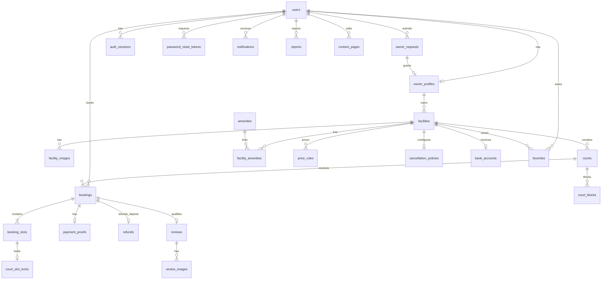

# Database Design

## Stabilization baseline — 2026-10-07

Phase cleanup không đổi schema, migration, constraint hoặc dữ liệu. Các aggregate read model Public Facility, Availability và Owner Booking chỉ đọc các bảng/field đã có bằng SQL tham số hóa và DTO whitelist; không thêm index hay materialized view. Query budget và performance evidence nằm trong ARCHITECTURE/FEATURE_STATUS. Report vẫn hoãn.

Booking Configuration Phase 1 dùng nguyên PriceRule/CancellationPolicy/BankAccount và FK/UNIQUE/CHECK. Owner PUT price delete+insert toàn bộ trong transaction khóa User → Facility; rules:[] được phép. Policy/bank upsert giữ cùng singleton record; bank update không ghi qr_image_path. Cutoff 0–168 và max48 rule là backend validation, không migration. Snapshot giao dịch bất biến. Chi tiết [BOOKING_CONFIGURATION_SPEC.md](specs/BOOKING_CONFIGURATION_SPEC.md).

Court Core Phase 1 (2026-09-26) dùng nguyên model/constraint hiện tại, không migration. Name trim + NFC tại backend, không case-insensitive UNIQUE. Mutation khóa Owner User → Facility → Court, recheck actor/ownership/state; CREATE đặt ACTIVE và created_at, Prisma quản lý updated_at. Đổi tên Court không sửa Booking.court_name_snapshot. Không DELETE hoặc chuyển Facility. Chi tiết [COURT_SPEC.md](specs/COURT_SPEC.md).

Baseline v1: Customer capability áp dụng cho cả Approved Owner khi dùng chức năng cá nhân; quyền quản lý Owner chỉ áp dụng tài nguyên cơ sở mình. PENDING_CONFIRMATION không countdown 5 phút, không tự expire, không cho Customer cancel; Owner phải Confirm hoặc Reject.

## Overview

Thiết kế logic PostgreSQL hosted trên Supabase, truy cập qua Prisma cho modular monolith. Ngày 2026-09-23 đã apply `20260922000000_init`: xác minh 24 bảng, 24 PK, 36 FK, 76 CHECK và các index; fixture kiểm thử đã rollback, Report tiếp tục hoãn. Chi tiết và giới hạn tại [Prisma Schema Review](plans/PRISMA_SCHEMA_REVIEW.md); các transaction/service nghiệp vụ chưa triển khai. Tuân [PROJECT_OVERVIEW.md](PROJECT_OVERVIEW.md), [BOOKING_SPEC.md](specs/BOOKING_SPEC.md), [PAYMENT_SPEC.md](specs/PAYMENT_SPEC.md).

Quy ước chung:

- PK mặc định `id BIGINT`; FK cùng kiểu. API biểu diễn ID dưới dạng string để tránh mất chính xác JavaScript.
- Mỗi bảng, trừ nơi ghi khác, có `created_at TIMESTAMPTZ(3) NOT NULL`, `updated_at TIMESTAMPTZ(3) NOT NULL`. FK và cột quan trọng không nullable trừ khi có dấu `NULL`.
- Lưu thời điểm UTC, kết nối DB dùng UTC; lịch giờ mở cửa/PriceRule dùng TIME theo Asia/Ho_Chi_Minh. Dùng thời gian DB cho hold, không dùng đồng hồ client.
- Database encoding UTF8. Status/enum giữ nguyên giá trị logic, dùng VARCHAR + CHECK theo danh sách đã mô tả; không đổi state machine. BOOLEAN là kiểu boolean PostgreSQL.
- Tiền VND: tổng/cọc/còn lại `NUMERIC(12,0)`; giá giờ `NUMERIC(12,0)`; giá nửa giờ trước làm tròn `NUMERIC(14,2)`. Tỷ lệ cọc cố định DEPOSIT_RATE = 30%, không là trường cấu hình của Owner. Không FLOAT/DOUBLE cho tiền.
- URL/object path `VARCHAR(1024)`, lý do/mô tả dài `TEXT`; file binary không nằm trong DB.
- FK mặc định RESTRICT khi xóa để giữ lịch sử. Không hard delete User/Facility/Court có tham chiếu booking; dùng status. Không thêm soft delete đại trà.
- Dữ liệu pending approval/report không được coi như đủ quy tắc để triển khai những TODO nghiệp vụ.

## ERD

Sơ đồ các quan hệ chính; danh mục Entities bên dưới là đầy đủ hơn.

## Entities

### users — tài khoản và hồ sơ

`id` PK; `email VARCHAR(254)`; `email_normalized VARCHAR(254)` UNIQUE; `password_hash VARCHAR(255) NULL` cho Google-only; `google_subject VARCHAR(255) NULL` UNIQUE; `full_name VARCHAR(150)`; `phone VARCHAR(30) NULL`; `avatar_path VARCHAR(1024) NULL`; `role VARCHAR(16)` = CUSTOMER/ADMIN; `status VARCHAR(16)` = ACTIVE/LOCKED; `locked_at TIMESTAMPTZ(3) NULL`; `locked_reason TEXT NULL`; timestamps.

Không xóa user có lịch sử; không trả password_hash/google_subject ra API profile. Index `(role, status, created_at)`. TODO quy tắc thay đổi email; Booking Phase 1 không yêu cầu phone; password policy theo AUTH_SPEC. role là vai trò nền, được service kiểm soát. Customer có owner_profiles được duyệt thì thêm Owner capability; users.role vẫn CUSTOMER. API capabilities được suy ra [CUSTOMER], [CUSTOMER, OWNER] hoặc [ADMIN], không là cột client sửa được. Không mô hình hóa CUSTOMER/OWNER loại trừ nhau, không cần bảng roles tổng quát. has_local_password là trường response suy ra từ password_hash khác NULL, không là cột ghi thêm; chỉ trả cho User đó khi đã đăng nhập.

### auth_sessions — phiên server

`id` PK; `user_id` FK users; `token_hash BYTEA` UNIQUE; `csrf_token CHAR(64)`; `expires_at TIMESTAMPTZ(3)`; `revoked_at TIMESTAMPTZ(3) NULL`; timestamps. Index `(user_id, revoked_at)`, `(expires_at)`. Lưu hash session token, cookie chứa opaque token; csrf_token ngẫu nhiên gắn với phiên để GET /auth/session trả cho frontend và xác minh header. CSRF token không thay thế session cookie để xác thực. Phiên cố định 7 ngày, không tự gia hạn. Có thể purge phiên hết hạn theo retention sẽ chốt.

### password_reset_tokens — token email dùng một lần, 15 phút

`id` PK; `user_id` FK users; `token_hash BYTEA` UNIQUE (SHA-256 của token ngẫu nhiên); `expires_at TIMESTAMPTZ(3)`; `used_at TIMESTAMPTZ(3) NULL`; `invalidated_at TIMESTAMPTZ(3) NULL`; timestamps. Index `(user_id, used_at, invalidated_at)`, `(expires_at)`.

Token sinh bằng CSPRNG, đề xuất 32 byte; expires_at = created_at + 15 phút, now >= expires_at không còn hợp lệ. Không có cột raw token. Raw token chỉ tồn tại tạm để gửi link HTTPS qua email sau commit, không lưu DB/log/outbox/queue.

Forgot chỉ tạo token cho User ACTIVE có password_hash; request mới vô hiệu token cũ bằng invalidated_at. Reset khóa User → token, kiểm tra hash/chưa dùng/chưa vô hiệu/chưa hết hạn, đổi password_hash, used_at và revoke session nguyên tử. Vô hiệu các token chưa dùng khác; hai reset đồng thời chỉ một thành công. Change password cũng vô hiệu reset tokens. Google-only không phát token, tiếp tục Google Login. TODO retention dữ liệu token và nhà cung cấp email, không còn TODO kênh hoặc TTL.

### owner_profiles — capability Owner đã được duyệt

`user_id` PK/FK users; `approved_request_id` FK owner_requests UNIQUE; timestamps. Chỉ tạo khi Admin approve OwnerRequest PENDING của cùng user_id và user.role=CUSTOMER. Service kiểm tra request đã chuyển APPROVED trong cùng transaction và approved_request_id thuộc User này.

User giữ role nền CUSTOMER và toàn bộ dữ liệu cá nhân; sự tồn tại profile hợp lệ cấp thêm OWNER. user_id PK ngăn cấp hai profile, approved_request_id UNIQUE giữ quan hệ nguồn duyệt. Không tự tạo Facility hoặc duyệt Facility. Không xóa profile khi một Facility bị REJECTED/SUSPENDED; khóa tài khoản vẫn dùng users.status.

Không thêm trường giấy tờ/pháp lý ngoài scope. Thông tin hiện hành lấy từ users, snapshot hồ sơ tại lần yêu cầu giữ trong owner_requests.

### owner_requests — lịch sử yêu cầu trở thành Owner

`id` PK; `user_id` FK users; `status VARCHAR(16)` = PENDING/APPROVED/REJECTED; `applicant_name_snapshot VARCHAR(150)`; `applicant_email_snapshot VARCHAR(254)`; `applicant_phone_snapshot VARCHAR(30) NULL`; `reviewed_by` FK users NULL; `reviewed_at TIMESTAMPTZ(3) NULL`; `rejection_reason TEXT NULL`; timestamps. Index `(status, created_at)`, `(user_id, created_at)`.

Ràng buộc một pending/user: partial unique index trên `owner_requests(user_id)` với predicate `WHERE status = 'PENDING'`. Không cần generated column trung gian. Chỉ các hàng PENDING chịu unique nên giữ được nhiều lần REJECTED lịch sử. Không dùng UNIQUE(user_id, status) vì sẽ cấm nhiều lần bị từ chối; không dùng UNIQUE(user_id) vì mỗi User được gửi request mới sau reject.

Tạo request: khóa users, kiểm tra ACTIVE/role CUSTOMER/chưa có OwnerProfile, kiểm tra PENDING, chụp hồ sơ hiện có rồi insert. Unique collision trả REQUEST_ALREADY_PENDING kể cả request đồng thời. Không nhận user_id/status/snapshot từ client. Body tạo rỗng, không cần bộ hồ sơ chưa được đặc tả.

Admin approve/reject khóa User → request và kiểm tra lại PENDING. APPROVED tạo owner_profiles(approved_request_id) trong cùng transaction, giữ users.role=CUSTOMER, revoke phiên cũ; không thay dữ liệu Customer/Facility. REJECTED bắt buộc rejection_reason không rỗng, lưu reviewer/time; không xóa hoặc đổi lại PENDING. Lần gửi sau tạo id mới, giữ nguyên snapshot và quyết định cũ.

CHECK/service kiểm tra PENDING có reviewer/time/reason NULL; APPROVED/REJECTED có reviewer/time; REJECTED có reason. Request kết thúc bất biến trong MVP, FK RESTRICT để bảo toàn lịch sử. Không có nhiều PENDING ngay cả khi worker/request ghi đồng thời.

### facilities — cơ sở thể thao

`id` PK; `owner_id` FK owner_profiles.user_id; `name VARCHAR(200)`; `address VARCHAR(500)`; `district VARCHAR(100)`; `latitude NUMERIC(10,7) NULL`; `longitude NUMERIC(10,7) NULL`; `phone VARCHAR(30)`; `description TEXT NULL`; `opening_time TIME`; `closing_time TIME`; `status VARCHAR(16)` = DRAFT/PENDING/ACTIVE/REJECTED/SUSPENDED; `submitted_at TIMESTAMPTZ(3) NULL`; `reviewed_by` FK users NULL; `reviewed_at TIMESTAMPTZ(3) NULL`; `rejection_reason TEXT NULL`; `suspended_at TIMESTAMPTZ(3) NULL`; `suspension_reason TEXT NULL`; timestamps.

Index `(owner_id, status)`, `(status, district)`, `(name)`. Tên không UNIQUE toàn hệ thống. B-tree name không đảm bảo tối ưu tìm contains; TODO đo tải/chọn full-text khi cần, không thêm search engine. District dùng danh mục 94 đơn vị cấp xã đã chốt; giờ qua đêm ngoài scope; chưa hỗ trợ closing_time <= opening_time. Public Phase 1 chỉ Facility ACTIVE của Owner User ACTIVE. Không hard delete Facility có booking.

### facility_images — ảnh cơ sở

`id` PK; `facility_id` FK facilities; `image_path VARCHAR(1024)`; `sort_order INTEGER`; timestamps. Index `(facility_id, sort_order)`. Ảnh thứ tự đầu làm ảnh đại diện theo quy ước UI; chưa thêm tính năng album phức tạp. Tối đa 10 ảnh/Facility; xem Facility Presentation bên dưới.

### courts — sân con

`id` PK; `facility_id` FK facilities; `name VARCHAR(100)`; `description TEXT NULL`; `status VARCHAR(16)` = ACTIVE/INACTIVE; timestamps. UNIQUE `(facility_id, name)`; index `(facility_id, status)`. Dùng INACTIVE thay xóa sân có lịch sử. Court ACTIVE vẫn không nhận booking nếu Facility không ACTIVE.

### amenities và facility_amenities — danh mục tiện ích

amenities: `id` PK; `name VARCHAR(100)` UNIQUE; `is_active BOOLEAN`; timestamps. Không tự tạo amenity ngoài dữ liệu Admin nhập.

facility_amenities: `facility_id` FK facilities + `amenity_id` FK amenities là PK kép; timestamps. Index `(amenity_id, facility_id)`. Owner chỉ nối danh mục hợp lệ; Admin ngừng sử dụng amenity bằng is_active, không xóa làm mất tham chiếu.

### price_rules — giá theo giờ cấp Facility

`id` PK; `facility_id` FK facilities; `start_time TIME`; `end_time TIME`; `hourly_rate NUMERIC(12,0)`; timestamps. UNIQUE `(facility_id, start_time, end_time)`; index `(facility_id, start_time)`.

Rule lặp hằng ngày dùng chung tất cả Court trong Facility. start_time < end_time, ranh giới 30 phút, giá dương, không overlap. UNIQUE không tự ngăn các khoảng overlap: service khóa Facility rồi kiểm tra toàn bộ tập rule. Thay toàn bộ bảng giá trong một transaction. Thiếu giá ở slot → không đặt. Chưa có day_of_week/holiday/court-specific rules.

### cancellation_policies — hủy trước X giờ

`id` PK; `facility_id` FK facilities UNIQUE; `cutoff_hours INTEGER`; timestamps. Snapshot vào booking. Customer hủy CONFIRMED chỉ khi DB current_time < start_at - cutoff_hours snapshot; đúng mốc bị từ chối. PENDING_PAYMENT không áp cutoff; PENDING_CONFIRMATION không cho hủy. Owner hủy CONFIRMED bắt buộc lý do và không áp cutoff Customer. Refund đủ điều kiện nằm ở bảng refunds riêng. Owner cấu hình X là integer 0–168 ở backend. TODO fallback khi thiếu snapshot; không tự đặt giá trị mặc định.

### bank_accounts — ngân hàng nhận cọc

`id` PK; `facility_id` FK facilities UNIQUE; `bank_name VARCHAR(150)`; `account_number VARCHAR(50)`; `account_holder VARCHAR(150)`; `qr_image_path VARCHAR(1024) NULL`; timestamps. Một tài khoản hiện hành/Facility trong MVP; không UNIQUE số tài khoản giữa cơ sở vì cùng Owner có thể dùng chung. Snapshot sang Booking, không expose public toàn bộ thông tin.

### bookings — giao dịch đặt sân

| Cột | Kiểu / ràng buộc | Ý nghĩa |
| --- | --- | --- |
| id | BIGINT PK | ID hiển thị tham chiếu |
| customer_id | BIGINT FK users | Lấy từ session CUSTOMER lúc tạo |
| court_id | BIGINT FK courts | Một Court/booking |
| status | VARCHAR(32) | PENDING_PAYMENT/PENDING_CONFIRMATION/CONFIRMED/COMPLETED/CANCELLED/REJECTED/EXPIRED |
| start_at, end_at | TIMESTAMPTZ(3) | Khoảng UTC, end > start |
| expires_at | TIMESTAMPTZ(3) NOT NULL | created_at + 5 phút, giữ cả sau submit |
| total_amount, deposit_amount, remaining_amount | NUMERIC(12,0) | Backend snapshot tổng/cọc 30%/trả tại sân 70%; không client quyết định |
| cancellation_cutoff_hours_snapshot | INTEGER NULL | NULL nếu chưa có policy, không hiểu là hủy tự do |
| bank_name_snapshot | VARCHAR(150) | Ngân hàng lúc đặt |
| account_number_snapshot | VARCHAR(50) | Số tài khoản lúc đặt |
| account_holder_snapshot | VARCHAR(150) | Chủ tài khoản lúc đặt |
| qr_image_path_snapshot | VARCHAR(1024) NULL | QR lúc đặt |
| facility_name_snapshot | VARCHAR(200) | Tên cơ sở lúc đặt |
| facility_address_snapshot | VARCHAR(500) | Địa chỉ lúc đặt |
| court_name_snapshot | VARCHAR(100) | Tên sân lúc đặt |
| confirmed_at, completed_at, cancelled_at, rejected_at, expired_at | TIMESTAMPTZ(3) NULL | Mốc chuyển trạng thái |
| cancelled_by | VARCHAR(16) NULL | CUSTOMER hoặc OWNER khi CANCELLED; backend lấy actor từ ngữ cảnh route đã xác thực, không status mới |
| rejection_reason, cancellation_reason | TEXT NULL | Từ chối proof bắt buộc lý do; Owner hủy CONFIRMED bắt buộc cancellation_reason, Customer tùy chọn |
| created_at, updated_at | TIMESTAMPTZ(3) | Theo quy ước chung |

Index `(customer_id, created_at)`, `(court_id, start_at, end_at)`, `(status, expires_at)`, `(status, start_at)`. Owner query join Court/Facility; không lưu owner_id trùng lặp. Không API chuyển quyền sở hữu Facility trong scope hiện tại.

Ràng buộc: deposit_amount = ROUND(total_amount * 30 / 100, 0) theo decimal nửa đơn vị lên; remaining_amount = total_amount - deposit_amount; tiền không âm. Tỷ lệ luôn 30%, phần 70% dùng phép trừ để tránh lệch làm tròn. Khi CANCELLED bắt buộc cancelled_by và cancelled_at; cancelled_by=OWNER phải có cancellation_reason không rỗng. Service kiểm tra quyền, state và cutoff theo snapshot. start/end trùng biên slot, start ở tương lai lúc tạo, expires_at cố định. Không soft delete booking. Không lưu remaining_payment_status trong MVP: Owner chỉ đánh dấu COMPLETED sau end_at, đã sử dụng sân và xử lý 70% trực tiếp; không có giao dịch/proof riêng cho phần 70%.

### booking_slots — lịch sử từng nửa giờ

`id` PK; `booking_id` FK bookings; `start_at TIMESTAMPTZ(3)`; `end_at TIMESTAMPTZ(3)`; `hourly_rate_snapshot NUMERIC(12,0)`; `slot_amount NUMERIC(14,2)`; timestamps. UNIQUE `(booking_id, start_at)`; index `(booking_id, end_at)`.

Mỗi row dài đúng 30 phút, tất cả row của booking liên tiếp và phủ start/end. Court lấy qua Booking để không có court_id mâu thuẫn. Giá snapshot không cần FK PriceRule vì bảng giá có thể thay. Không UNIQUE theo Court/thời điểm ở bảng này: booking đã EXPIRED/REJECTED/CANCELLED vẫn giữ lịch sử.

### court_slot_locks — slot đang được giữ

`court_id` FK courts; `start_at TIMESTAMPTZ(3)`; `booking_slot_id` FK booking_slots UNIQUE; `created_at TIMESTAMPTZ(3)`; `updated_at TIMESTAMPTZ(3)`. PK kép `(court_id, start_at)`.

Một row bảo vệ một slot của booking đang giữ chỗ. Backend phải xác minh court_id/start_at khớp BookingSlot → Booking trong transaction; FK đơn không tự chứng minh quan hệ này. PK là lớp phòng vệ cuối chống hai booking giữ cùng slot. Truy qua booking_slot_id để biết booking/status/expiry, không copy expires_at vào lock gây lệch.

Khi EXPIRED/REJECTED/CANCELLED/COMPLETED, xóa row khóa trong cùng transaction đổi status; không xóa booking_slots. PENDING_CONFIRMATION và CONFIRMED giữ row. Writer dọn khóa của PENDING_PAYMENT quá hạn trước khi cấp lại; không để khóa cũ gây xung đột giả.

### payment_proofs — chứng từ cọc 30% Customer → Owner

Payment Backend Phase1 triển khai và kiểm chứng ngày2026-10-06, schema hiện có đủ nên không migration. image_path lưu Cloudinary authenticated object identifier UUID (không filename hoặc URL ký), MIME/size từ ảnh đã validate. Không cần cột TTL/pixel/transfer_reference: URL đọc riêng tư TTL 300 giây đã được triển khai, pixel/frame do validation, transfer text `BOOKING <booking_id>` derive từ ID. UNIQUE booking_id + khóa Booking bảo vệ duplicate; nhận proof và PENDING_CONFIRMATION nguyên tử, giữ slot locks. File upload/cleanup ngoài transaction; khi kết quả COMMIT chưa rõ, service chờ cùng lock order và kiểm tra reference trước destroy. Customer GET proof và QR snapshot delivery đã triển khai mà không đổi các cột path/snapshot hiện có.

`id` PK; `booking_id` FK bookings UNIQUE; `image_path VARCHAR(1024)`; `mime_type VARCHAR(100)`; `size_bytes BIGINT`; `status VARCHAR(16)` = SUBMITTED/APPROVED/REJECTED; `submitted_at TIMESTAMPTZ(3)`; `reviewed_by` FK users NULL; `reviewed_at TIMESTAMPTZ(3) NULL`; `rejection_reason TEXT NULL`; timestamps.

Index `(status, submitted_at)`. Một proof/booking trong thiết kế gửi lại bằng booking mới. reviewed_by phải là Owner sở hữu Facility (service kiểm tra). Khi REJECTED bắt buộc lý do; file riêng tư. Không soft delete hoặc sửa proof sau khi duyệt. Không dùng bảng này cho 70% hoặc refund. PENDING_CONFIRMATION có proof SUBMITTED phải được Owner Confirm/Reject, không có nhánh Customer cancel; proof của booking kết thúc không được xử lý lại.

### refunds — hoàn 100% cọc đã xác nhận, do hai bên chuyển tiền thủ công

Một Booking tối đa một Refund, tạo trong transaction hủy hợp lệ từ CONFIRMED có PaymentProof APPROVED. Hủy PENDING_PAYMENT không tạo Refund; PENDING_CONFIRMATION không cho hủy. Không có API tạo refund tùy ý hoặc hoàn phần 70% tại sân.

| Cột | Kiểu / ràng buộc | Ý nghĩa |
| --- | --- | --- |
| id | BIGINT PK | ID refund |
| booking_id | BIGINT NOT NULL FK bookings, UNIQUE | Tối đa một record/booking |
| amount | NUMERIC(12,0) NOT NULL | Bằng 100% bookings.deposit_amount snapshot, server quyết định |
| status | VARCHAR(32) NOT NULL | PENDING/PROOF_SUBMITTED/REFUNDED; không phải Booking enum |
| reason | TEXT NOT NULL | Lý do hủy, hoặc mô tả hệ thống khi Customer không nhập lý do |
| proof_image_path | VARCHAR(1024) NULL | Ảnh riêng tư Owner hoàn cọc cho Customer |
| proof_mime_type | VARCHAR(100) NULL | Metadata kiểm tra upload |
| proof_size_bytes | BIGINT NULL | Kích thước file |
| requested_at | TIMESTAMPTZ(3) NOT NULL | Thời điểm hủy phát sinh nghĩa vụ hoàn cọc |
| proof_submitted_at | TIMESTAMPTZ(3) NULL | Server chấp nhận ảnh hoàn cọc |
| refunded_at | TIMESTAMPTZ(3) NULL | Thời điểm hệ thống ghi nhận hoàn tiền hoàn tất khi Customer xác nhận |
| confirmed_at | TIMESTAMPTZ(3) NULL | Customer xác nhận đã nhận tiền; cùng thời điểm refunded_at trong MVP |
| created_at, updated_at | TIMESTAMPTZ(3) NOT NULL | Lịch sử bản ghi |

Index `(status, requested_at)` cho Owner lọc việc cần xử lý; UNIQUE booking_id cũng phục vụ join. Customer/Owner suy ra qua Booking → Customer hoặc Court → Facility, không copy owner_id/customer_id dễ lệch. FK RESTRICT; không soft/hard delete refund có lịch sử.

Constraint trong một hàng: amount không âm; PENDING có proof/timestamps xác nhận NULL; PROOF_SUBMITTED bắt buộc proof_image_path/metadata/proof_submitted_at nhưng confirmed_at/refunded_at NULL; REFUNDED giữ proof, bắt buộc confirmed_at/refunded_at. Thứ tự requested_at <= proof_submitted_at <= confirmed_at, refunded_at = confirmed_at. refunded_at không khẳng định giờ giao dịch ngân hàng thực tế.

Ràng buộc liên bảng do service dưới khóa: Booking CANCELLED, cọc APPROVED, amount bằng deposit snapshot; actor hủy hợp lệ; Owner sở hữu mới upload, Customer sở hữu mới xác nhận. CHECK/FK đơn không đủ kiểm tra các điều kiện liên bảng. Booking CONFIRMED thiếu proof APPROVED là lỗi dữ liệu và phải rollback cancellation, không tạo số tiền tùy ý.

Luồng tuyến tính `PENDING → PROOF_SUBMITTED → REFUNDED`; một proof nhận thành công, không chỉnh amount hoặc mở lại state. Các timestamp + proof + reason giữ lịch sử MVP, chưa cần bảng event riêng. Upload thành công không đồng nghĩa tiền đã đến; chỉ Customer xác nhận mới REFUNDED. Không giữ slot trong bất kỳ Refund state nào.

TODO cách trao đổi tài khoản nhận hoàn tiền, xử lý tranh chấp/proof sai hoặc Customer chưa phản hồi; chưa bổ sung Customer bank account, nhánh reject/resubmit refund proof hoặc auto-confirm.

### court_blocks — khóa lịch

`id` PK; `court_id` FK courts; `start_at TIMESTAMPTZ(3)`; `end_at TIMESTAMPTZ(3)`; `reason TEXT`; `created_by` FK users; timestamps. Index `(court_id, start_at, end_at)`; end > start. Overlap booking giữ chỗ bị từ chối dưới khóa Court. Các block có thể overlap nhau. Xóa block là mở đúng khoảng do block đó áp đặt; không tác động block khác hoặc booking. Chưa có yêu cầu audit lâu dài cho block bị xóa; TODO retention nếu cần.

### favorites — cơ sở yêu thích

`user_id` FK users + `facility_id` FK facilities là PK kép; timestamps. Index `(facility_id, user_id)`. Người có Customer capability (kể cả Approved Owner) tạo favorite cho Facility ACTIVE; danh sách đã lưu có thể trả trạng thái unavailable khi cơ sở không còn public, không lộ dữ liệu quản trị.

### reviews và review_images — đánh giá

reviews: `id` PK; `booking_id` FK bookings UNIQUE; `rating SMALLINT` CHECK 1..5; `comment TEXT NULL`; `status VARCHAR(16)` = VISIBLE/HIDDEN; `moderated_by` FK users NULL; `moderated_at TIMESTAMPTZ(3) NULL`; `moderation_reason TEXT NULL`; timestamps. Index `(status, created_at)`.

Customer và Facility được suy ra qua Booking; không copy author/facility_id gây lệch. Service chỉ tạo khi booking COMPLETED và Customer sở hữu. UNIQUE tồn tại cả khi review HIDDEN, không cho review lần hai. TODO policy sửa/xóa review; hiện không có API sửa/xóa Customer. Public rating tính từ review VISIBLE; công thức làm tròn và xếp hạng còn TODO.

review_images: `id` PK; `review_id` FK reviews; `image_path VARCHAR(1024)`; `sort_order INTEGER`; timestamps; index `(review_id, sort_order)`. Feature P3, giới hạn số ảnh TODO. Ẩn review thì không hiển thị ảnh qua UI public.

### notifications — thông báo trong website

`id` PK; `recipient_id` FK users; `event_type VARCHAR(64)`; `event_key VARCHAR(191)`; `title VARCHAR(200)`; `message TEXT`; `booking_id` FK bookings NULL; `facility_id` FK facilities NULL; `owner_request_id` FK owner_requests NULL; `review_id` FK reviews NULL; `read_at TIMESTAMPTZ(3) NULL`; timestamps.

UNIQUE `(recipient_id, event_key)` chống trùng khi retry. Index `(recipient_id, read_at, created_at)`. Dùng FK đích cụ thể, không lưu URL tùy ý từ client. Nội dung tiếng Việt, không nhúng proof/sensitive data. Mark all read cập nhật chỉ recipient hiện tại.

| event_type | Người nhận thiết kế |
| --- | --- |
| BOOKING_CREATED | Customer đặt booking |
| PAYMENT_PROOF_SUBMITTED | Owner của Facility |
| PAYMENT_CONFIRMED | Customer của booking |
| PAYMENT_REJECTED | Customer của booking |
| BOOKING_CANCELLED | Customer và Owner liên quan |
| BOOKING_EXPIRED | Customer của booking |
| OWNER_REQUEST_APPROVED / OWNER_REQUEST_REJECTED | Người gửi request |
| FACILITY_APPROVED / FACILITY_REJECTED | Owner của Facility |
| NEW_REVIEW | Owner của Facility |

Event ghi cùng transaction thay đổi khi module notification triển khai. Đây là quy ước người nhận tối thiểu, không thêm email/SMS/broadcast của Admin. Trong P1 chưa có notification, không đánh dấu event đã được triển khai.

### reports — báo cáo cần quản trị

Khung dữ liệu dự kiến: `id` PK; `reporter_id` FK users; `reason TEXT`; `status VARCHAR(16)` dự kiến OPEN/RESOLVED; `handled_by` FK users NULL; `handled_at TIMESTAMPTZ(3) NULL`; `resolution_note TEXT NULL`; timestamps. Index `(status, created_at)`, `(reporter_id, created_at)`.

**TODO chưa đủ schema để triển khai:** đối tượng được report (review/facility/booking hay loại khác), FK mục tiêu, người được gửi, loại lý do và hành động xử lý. Không tạo polymorphic target_id không kiểm soát; bổ sung FK cụ thể sau khi chốt. API report là reserved, chưa nhận dữ liệu cho đến khi hoàn thiện phần này. Không tự thêm ban/report escalation.

### content_pages — nội dung cơ bản

Thiết kế dự kiến cho trang nội dung: `id` PK; `slug VARCHAR(150)` UNIQUE; `title VARCHAR(200)`; `body TEXT`; `is_published BOOLEAN`; `updated_by` FK users; timestamps. Index `(is_published, slug)`.

TODO loại nội dung, format body và các trang/slug thực sự cần quản trị; không tự tạo bài mẫu/trang giả. Nếu sử dụng rich text, sanitize trước render. API content reserved đến khi chốt. P3 mở rộng quản lý nội dung, không thêm CMS độc lập.

## Relationships

User CUSTOMER có thể có một owner_profiles được duyệt, nhận thêm capability OWNER và quản lý nhiều facilities; vẫn có đầy đủ quan hệ booking/favorite/review/refund Customer. Facility có nhiều courts/images/price_rules; nhiều amenities qua facility_amenities; tối đa một bank/cancellation config hiện hành; cọc cố định 30% toàn hệ thống. Một Customer có nhiều bookings, một Court có nhiều bookings theo thời gian. Booking có nhiều booking_slots và tối đa một payment_proof, một review và một refund. Mỗi slot có tối đa một khóa đang hoạt động. Review có nhiều ảnh. Notifications thuộc đúng một recipient, tham chiếu đối tượng có kiểm soát.

Phân quyền dựa trên quan hệ này, không dựa vào owner_id/customer_id do client nhập. FK chỉ bảo vệ tồn tại, service còn phải kiểm tra role/ownership/trạng thái.

## Constraints và Soft Delete

- Không dùng soft delete cho booking/payment/refund/review để tránh bypass UNIQUE và mất lịch sử. Review moderation dùng HIDDEN.
- User khóa bằng LOCKED, Court ngừng bằng INACTIVE, Facility đình chỉ bằng SUSPENDED; không tự xóa phụ thuộc.
- PriceRule/giờ hoạt động/ngân hàng là cấu hình hiện tại, booking snapshot không đổi theo.
- CHECK không thay được việc kiểm tra khoảng overlap, chuỗi slot liên tiếp, ownership hoặc trạng thái nguồn; phải dùng service transaction.
- Tạo notification không được làm transition chạy lặp; UNIQUE event_key và kiểm tra status trước ghi.
- Giới hạn trường, dấu thập phân, enum, rating, FK và UNIQUE kiểm tra cả phía API/DB; không tin request hợp lệ vì UI có validate.

## Indexes

Các index được ghi tại từng bảng; trọng tâm: bookings(status, expires_at) cho worker, bookings(customer_id, created_at) cho lịch sử, courts(facility_id, status) và facilities(owner_id, status) cho Owner, PK court_slot_locks cho giữ chỗ, court_blocks(court_id, start_at, end_at) cho overlap, notifications(recipient_id, read_at, created_at) cho inbox.

Không thêm index cho mọi cột. Search rating/price/popularity và thống kê sẽ được thiết kế truy vấn sau khi chốt công thức, đo bằng query plan; chưa cần bảng tổng hợp/cache riêng.

## Booking Concurrency và Double Booking Prevention

Booking Phase 1 spec chốt ngày 2026-10-03, backend đã triển khai và kiểm chứng ngày 2026-10-04: schema hiện tại đáp ứng create/list/detail, snapshot và lazy expiry; không migration/index mới. Snapshot amount NUMERIC(12,0) tối đa999999999999; slot_amount NUMERIC(14,2) tối đa999999999999.99. Service phải kiểm tra giá trị tính ra trước INSERT và trả422 BOOKING_AMOUNT_TOO_LARGE, không phát lộ numeric overflow. Giới hạn1–6slot, cùng ngày local, start tương lai và tối đa30×24giờ do service enforce; không sửa initial migration.

Transaction create dùng ReadCommitted và DB clock_timestamp() sau khi đủ khóa, created_at theo mốc đó, expires_at=created_at+5phút. Atomic expiry liên quan + Booking + BookingSlot + CourtSlotLock; create rollback cũng rollback cleanup của transaction đó. Detail chỉ lazy-expire booking sở hữu, commit trước response. List RepeatableRead chỉ đọc, cùng snapshot cho count/items/server_time và biểu diễn status hiệu lực; không sweep nhiều Court/Facility. Không thêm cột effective_status. Contract và audit source lock order tại BOOKING_SPEC; bằng chứng test writer/rollback/cleanup tại FEATURE_STATUS.

1. Bắt đầu transaction; khóa Customer/Owner User theo ID số tăng dần, loại trùng, rồi Facility → Court. Đọc lại trạng thái/cấu hình trong transaction, không sử dụng snapshot frontend.
2. Tìm PENDING_PAYMENT của Court đã hết hạn; khóa Booking theo id tăng dần, kiểm tra lại DB time/status, đổi EXPIRED và xóa slot locks.
3. Kiểm tra khoảng thời gian/giá/CourtBlock và slot locks còn hiệu lực.
4. Insert Booking, BookingSlot, court_slot_locks; PK(court_id, start_at) chặn tranh chấp còn sót. Tất cả thành công mới commit.
5. Lỗi constraint/deadlock rollback toàn bộ; retry hữu hạn hoặc trả lỗi conflict/thử lại, không thành công từng phần.

Mọi ghi ảnh hưởng availability phải theo thứ tự User (ID tăng dần, loại trùng) → Facility → Court → Booking → PaymentProof → Refund → slot locks. Không lấy thêm User lock sau Facility/Court; lazy expiry không khóa Customer của booking cũ, không thay FK User. Batch nhiều Court/Booking khóa theo id tăng dần. Tác vụ đổi cấu hình khóa Facility, nên không chen vào lúc tạo snapshot. CourtBlock dùng cùng khóa, kiểm tra overlap không thể chỉ dựa PK slot vì block có khoảng giờ tự do.

Availability bỏ hold quá hạn ngay về mặt logic; writer thu hồi khóa vật lý trước cấp mới. Phase 1 dùng lazy expiry tại create/detail; worker deferred. Worker tương lai chỉ xử lý PENDING_PAYMENT, không expire PENDING_CONFIRMATION. Không cần transaction phân tán hay Redis lock.

## Transaction Boundaries

| Use case | Phần nguyên tử trong PostgreSQL |
| --- | --- |
| Create booking | Dọn expiry liên quan + kiểm tra + Booking + BookingSlot + slot locks + notification nếu có |
| Submit proof | Kiểm tra quyền/hạn/status + PaymentProof SUBMITTED + Booking PENDING_CONFIRMATION + notification |
| Confirm proof | Proof APPROVED + Booking CONFIRMED/confirmed_at + notification |
| Reject proof | Proof REJECTED/lý do + Booking REJECTED/lý do + xóa locks + notification |
| Expire | Kiểm tra lại hạn/status + EXPIRED/expired_at + xóa locks + notification |
| Customer/Owner cancel | Kiểm tra quyền/state/cutoff + CANCELLED/cancelled_by/reason/cancelled_at + xóa locks + Refund PENDING đủ điều kiện + notification; giữ proof lịch sử |
| Owner submit refund proof | Sau upload ngoài transaction: kiểm tra ownership/Booking CANCELLED/Refund PENDING + lưu proof/metadata/time + PROOF_SUBMITTED |
| Customer confirm refund | Kiểm tra ownership/Booking CANCELLED/Refund PROOF_SUBMITTED + REFUNDED + confirmed_at/refunded_at, không đổi Booking/locks |
| Complete | CONFIRMED, đã qua end_at, Owner ghi nhận đã dùng sân/xử lý 70% trực tiếp → COMPLETED/completed_at + xóa locks |
| CourtBlock create/delete | Khóa chung, kiểm tra xung đột và ghi/xóa block |
| Đổi bảng giá/chính sách/giờ | Khóa Facility, validate cấu hình rồi thay nguyên tập cần thiết |
| Owner request create | Khóa User, snapshot hồ sơ + insert PENDING; partial UNIQUE(user_id) WHERE status = 'PENDING' chặn request đồng thời |
| Owner request approve/reject | Khóa User rồi request; lưu quyết định/lý do; approve tạo profile, giữ CUSTOMER + thêm OWNER, revoke session; notification nếu có |
| Forgot password | Khóa User, invalidated_at token cũ + insert token_hash có TTL 15 phút; gửi email sau commit |
| Reset/change password | Khóa User rồi token, đổi password_hash + used_at/invalidated_at + revoke sessions nguyên tử |
| Facility approve/reject | Khóa Owner User → Facility, kiểm tra PENDING, đổi status/lý do và notification |
| Review create | Kiểm tra booking sở hữu COMPLETED + insert UNIQUE review + notification |
| Lock user / reset/change password | Đổi trạng thái/hash + thu hồi session/token liên quan |

Cancellation/confirm/complete chạy đồng thời phải đọc lại state dưới khóa chung. Nếu cancel PENDING_PAYMENT sau expires_at, commit EXPIRED và nhả locks rồi trả BOOKING_EXPIRED; không rollback expiry do lỗi phản hồi. Cancellation CONFIRMED tạo refund hoặc rollback toàn bộ, UNIQUE booking_id chống tạo hai refund. Refund còn chờ không chặn cấp lại slot. Upload storage/Google network nằm ngoài transaction. File không được tham chiếu dọn riêng; không rollback DB bằng cách gọi storage trong khi giữ khóa. Notification nghiệp vụ chỉ ghi DB, không gửi email/SMS; email reset thuộc auth và gửi ngoài transaction. TODO retention, audit moderation và backup chi tiết trước production.

## Ánh xạ PostgreSQL và Prisma

- Prisma là lớp truy cập database; datasource khi implementation dùng `provider = "postgresql"`. Chưa cài Prisma, chưa tạo schema hoặc migration.
- ID BIGINT sinh tự động bằng identity/sequence, ánh xạ Prisma BigInt; PK/FK giữ cùng kiểu và ID trả API dạng string. Các ID phải dương; cột kích thước file, sort_order và cutoff_hours dùng CHECK >= 0 để giữ miền giá trị không âm. Rating SMALLINT có CHECK từ 1 đến 5.
- Thời điểm dùng TIMESTAMPTZ(3), ánh xạ DateTime với native type tương ứng; giờ lặp trong ngày dùng TIME WITHOUT TIME ZONE (TIME trong danh mục), theo Asia/Ho_Chi_Minh. created_at/updated_at phải được ghi nhất quán; PostgreSQL không tự cập nhật updated_at khi UPDATE, implementation dùng Prisma @updatedAt và ghi rõ ở các câu raw SQL.
- token_hash BYTEA có CHECK octet_length(token_hash) = 32; ánh xạ Prisma Bytes. Giữ hash SHA-256 và không lưu raw token.
- Tiền NUMERIC(12,0), giá slot NUMERIC(14,2) ánh xạ Prisma Decimal với precision/scale tương ứng. Không chuyển tiền sang JavaScript Number để tính toán; giữ quy tắc làm tròn và snapshot đã chốt. Tọa độ dùng NUMERIC(10,7), không thay ý nghĩa.
- Các FK, PK kép, UNIQUE và index hiện có giữ nguyên. PostgreSQL không tự tạo index cho mọi FK; dùng các index truy vấn đã liệt kê, rà query plan khi triển khai. Chuỗi dùng collation được chọn rõ khi implementation; không ngầm giả định so sánh không phân biệt hoa/thường. email_normalized vẫn là khóa email chuẩn hóa.
- Partial unique index Owner Request phải hiện diện thật trong DB, không chỉ service validation. Kiểm tra khả năng biểu diễn theo phiên bản Prisma được chọn; nếu cần thì quản lý bằng SQL tùy chỉnh trong migration sau này. Các CHECK cũng phải được giữ bằng migration phù hợp, không bỏ vì ORM chưa biểu diễn.
- Transaction dự kiến READ COMMITTED, khóa hàng bằng SELECT ... FOR UPDATE theo thứ tự đã chốt. Prisma dùng cùng transaction client cho tất cả thao tác; câu khóa/raw SQL được tham số hóa. Không chuyển thành SELECT availability rồi INSERT ngoài transaction.
- Sau khi lấy đủ khóa, đọc clock_timestamp() từ DB để xét expiry/cutoff và thời điểm tạo booking. Không dùng now()/CURRENT_TIMESTAMP làm thời gian sau chờ khóa vì chúng cố định tại đầu transaction. Lấy một mốc tại mỗi quyết định và dùng nhất quán; expires_at vẫn created_at + 5 phút.
- PK court_slot_locks(court_id, start_at) tiếp tục là ràng buộc duy nhất chống chiếm cùng slot. UNIQUE violation rollback toàn transaction; deadlock/serialization failure retry hữu hạn toàn transaction. Nhả khóa cùng transaction EXPIRED/REJECTED/CANCELLED/COMPLETED, giữ booking_slots lịch sử.

## Kết nối và triển khai dự kiến

Backend local và backend production kết nối PostgreSQL trên Supabase qua DATABASE_URL ở môi trường server. React chỉ gọi Express REST API, không có DB credential hoặc kết nối DB trực tiếp. Supabase chỉ là PostgreSQL hosting provider; không dùng Supabase Auth, Storage, Realtime hoặc Edge Functions.

Nếu công cụ migration/deployment cần direct connection riêng, chuẩn bị DIRECT_URL hoặc cấu hình tương đương ở bước implementation. TODO chốt phiên bản Prisma/PostgreSQL, chế độ direct/pooler, giới hạn pool, TLS và đường kết nối migration phù hợp môi trường; không giả định direct URL hoặc tên biến tự được Prisma sử dụng. Chưa tạo Supabase project hoặc kết nối database. Không ghi connection string thật, mật khẩu, API key hoặc secret trong tài liệu/Git.

Tài liệu tham chiếu: [PostgreSQL partial indexes](https://www.postgresql.org/docs/current/indexes-partial.html), [PostgreSQL thời gian hiện tại](https://www.postgresql.org/docs/current/functions-datetime.html#FUNCTIONS-DATETIME-CURRENT), [Supabase với Prisma](https://supabase.com/docs/guides/database/prisma).

## Owner Request implementation — 2026-09-25

Giữ nguyên schema/migration đã apply. Service tạo request khóa applicant User, đọc lại trạng thái/profile/PENDING rồi insert snapshot; partial UNIQUE hiện có tiếp tục bảo vệ database. Approve/reject khóa Applicant User → OwnerRequest, kiểm tra lại PENDING trong transaction. Approve cập nhật quyết định, tạo OwnerProfile đúng applicant/approved_request_id và revoke session nguyên tử; reject lưu lịch sử và không tạo profile. reviewed_at dùng clock_timestamp() của database. Giới hạn rejection_reason 1–500 ký tự sau trim được validate tại backend; không thêm CHECK/migration mới.

List dùng snapshot transaction RepeatableRead để danh sách và total nhất quán. Integration concurrency dùng các kết nối thật và fixture commit tạm với email UUID @example.invalid; cleanup theo đúng tập ID/email fixture, xóa session → profile → request → user trong transaction. Không xóa dữ liệu thật và không reset sequence; sequence có thể tăng dù fixture đã dọn.

## Facility Core Phase 1 — 2026-09-25

Các quyết định Phase 1 tại [FACILITY_SPEC.md](specs/FACILITY_SPEC.md). Quyết định này thay các TODO trước đó về edit/checklist/validation core: sửa chỉ DRAFT/REJECTED; submit/approve/activate chỉ yêu cầu core hợp lệ, không cần module con. ACTIVE chưa đồng nghĩa booking-ready. Registry district đã được chốt: 94 đơn vị hành chính cấp xã của TP Đà Nẵng (23 phường, 70 xã, 1 đặc khu), theo Nghị quyết 1659/NQ-UBTVQH15 ngày 16/06/2025. `district` là tên field legacy trong API/schema, biểu diễn phường/xã/đặc khu, không biểu diễn quận/huyện. UI sau này dùng nhãn Khu vực hoặc Phường/Xã. Không public search/frontend/module con/notification trong phase này.

Facility core Phase 1 không thay schema. Runtime ghi created_at/submitted_at/reviewed_at/suspended_at bằng DB clock_timestamp; Prisma quản lý updated_at. Không có audit table: metadata trên Facility thể hiện quyết định hiện hành, clear theo FACILITY_SPEC khi REJECTED → DRAFT và SUSPENDED → ACTIVE; không xóa Facility hay bản ghi quan hệ. Test fixture riêng có thể được xóa theo ID/email UUID đã tạo để cleanup, không phải chức năng DELETE Facility.

## Facility Presentation — quyết định 2026-09-28

FacilityImage image_path lưu Cloudinary public_id; cố định image/upload và cloud environment, ID bất biến không overwrite. Không metadata persistent mới hoặc migration. Max10, sort_order liên tục 0..n-1 do service dưới khóa. Amenity name trim+NFC 1–100, UNIQUE hiện tại, service default active; deactivate giữ liên kết. Assignment replace-all nguyên tử chỉ ACTIVE, [] hợp lệ. Chi tiết specs/FACILITY_PRESENTATION_SPEC.md.

Facility Presentation implementation giữ nguyên schema/constraint: transaction User → Facility, Amenity ID tăng dần khi replace; Admin deactivate khóa Amenity. Upload/storage ngoài transaction. DB insert lỗi kiểm tra tham chiếu trước cleanup khi COMMIT có thể không rõ; không xóa asset còn được tham chiếu. Không job orphan reconciliation Phase 1, không cần metadata/queue table mới.

## Public Facility Phase 1 — schema assessment

Schema đủ theo PUBLIC_FACILITY_SPEC: facilities → owner_profiles → users cho visibility; facility_images, facility_amenities/amenities, courts, price_rules, cancellation_policies cho DTO. Không đọc bank_accounts/slot hoặc thêm persistent metadata. Các index quan hệ hiện có đủ để bắt đầu; name B-tree không đảm bảo tối ưu contains. Chỉ cân nhắc index mới sau query plan/bằng chứng implementation. Hiện không migration/index mới, không sửa initial migration; chưa benchmark database.

## Availability Phase 1 — thiết kế đọc

AVAILABILITY_SPEC.md dùng schema/index hiện hữu, không migration. Booking.status/expires_at và khoảng thời gian xác định occupancy hiệu lực; CourtBlock xác định block. BookingSlot là lịch sử, lock tồn tại không đủ kết luận còn giữ chỗ. Reader bỏ qua hold hết hạn/booking kết thúc dù lock vật lý còn; không cấp/nhả lock hoặc đổi state. Không coi booking hiệu lực là trống chỉ vì thiếu lock.

Đọc theo Court/ngày trong snapshot nhất quán, một clock_timestamp() dùng toàn response; batch rules/blocks/booking, không N+1 theo slot. Có thể join lock→slot→booking nhưng phải giữ semantics hiệu lực; không quét lịch sử BookingSlot để coi mọi row là bận. Chưa benchmark, không index mới khi chưa có bằng chứng cần.
