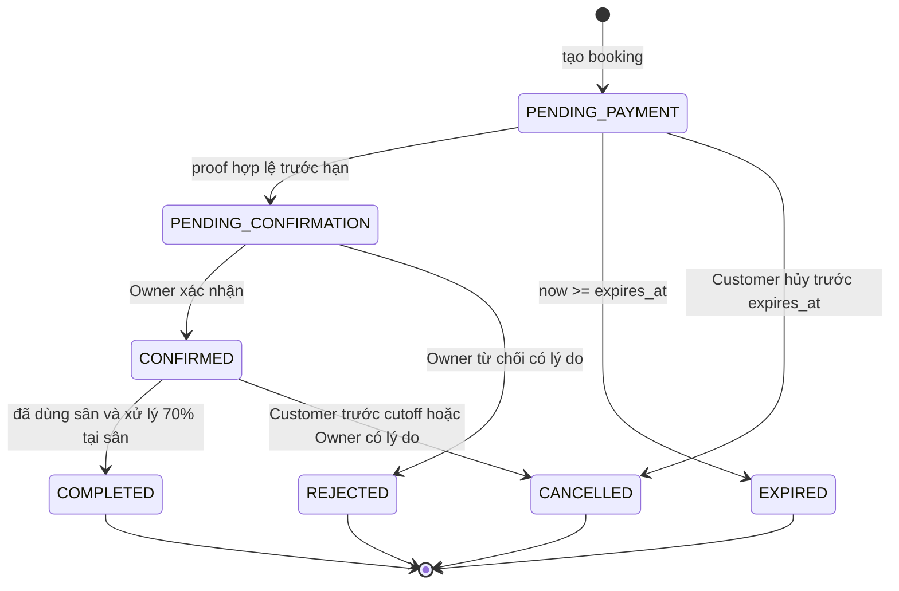

# Booking Specification

## Customer Payment Phase A — 2026-10-08 (HISTORICAL/SUPERSEDED)

Backend đã triển khai hủy booking cá nhân qua `POST /api/v1/bookings/:booking_id/cancel` cho duy nhất `PENDING_PAYMENT` còn hạn và chưa có PaymentProof. Mutation khóa theo thứ tự Booking hiện hành, kiểm tra lại dưới khóa, chuyển `CANCELLED`, ghi `cancelled_at/cancelled_by= CUSTOMER/cancellation_reason`, nhả `CourtSlotLock` và giữ `BookingSlot`. Lazy expiry thắng race trả `BOOKING_EXPIRED`; `PENDING_CONFIRMATION` hoặc đã có proof trả `CANCELLATION_NOT_ALLOWED`; các trạng thái kết thúc khác trả `INVALID_BOOKING_STATE`. Nhánh hủy `CONFIRMED` theo cutoff/Refund vẫn chưa thuộc Phase A.

Booking Detail trả bank/amount/deadline snapshot và `qr_image_url` nullable, không trả `qr_image_path_snapshot`. QR chỉ được phép resolve từ snapshot của Booking; tại Phase A URL từng trả null vì storage/lifecycle QR chưa được chứng minh. Hiện signed QR delivery từ Booking snapshot đã triển khai; tuyệt đối không đọc BankAccount live hoặc tạo URL giả.

## Current implementation baseline — 2026-10-07

Create/list/detail, frontend Booking, lazy expiry, PaymentProof handoff, Owner confirm/reject, Customer và Owner hủy `CONFIRMED` đã triển khai. `PENDING_CONFIRMATION` không countdown/auto-expire/Customer cancel; Owner phải confirm hoặc reject. Cả hai nhánh hủy `CONFIRMED` đủ điều kiện đều tạo Refund `PENDING` nguyên tử, nhả slot locks và giữ lịch sử; Refund processing `PENDING → PROOF_SUBMITTED → REFUNDED` cũng đã triển khai. Expiry worker và completion tự động vẫn deferred theo `FEATURE_STATUS.md`.

Payment Backend Phase1 đã triển khai và kiểm chứng ngày2026-10-06 theo PAYMENT_SPEC: nhận một proof hợp lệ trước DB expiry → PENDING_CONFIRMATION, giữ locks, không gia hạn; nhận proof booking cũ không tái áp Facility ACTIVE/Court ACTIVE/Owner ACTIVE nhưng Customer phải ACTIVE. Bank và QR snapshot giữ nguyên; QR delivery và Owner review đã triển khai ở các phase sau. Lock order và expiry dùng chung helper transaction với Booking backend.

Các Owner configuration APIs triển khai riêng theo [BOOKING_CONFIGURATION_SPEC.md](BOOKING_CONFIGURATION_SPEC.md). Price replace toàn bộ, policy/bank upsert không sửa snapshot cũ. Booking Phase 1 đã triển khai create/list/detail và lazy expiry; giữ điều kiện giá/ngân hàng bắt buộc, policy không bắt buộc khi create, fallback hủy thiếu cutoff như dưới đây. Không đổi tính slot/rounding/cọc30%/remaining70%.

Court Core theo [COURT_SPEC.md](COURT_SPEC.md) cho đổi name dù có Booking, không sửa court_name_snapshot lịch sử. ACTIVE/INACTIVE không tự hủy/xóa Booking, CourtSlotLock hoặc CourtBlock. Court tồn tại chưa đủ booking-ready. PENDING_CONFIRMATION tiếp tục giữ slot không expiry, mapping HELD theo [AVAILABILITY_SPEC.md](AVAILABILITY_SPEC.md), không được hiển thị AVAILABLE; Availability, Booking writer, Payment core và Refund workflow đã triển khai. Expiry worker và notification vẫn deferred.

Baseline v1: Customer capability áp dụng cho cả Approved Owner khi dùng chức năng cá nhân; quyền quản lý Owner chỉ áp dụng tài nguyên cơ sở mình. PENDING_CONFIRMATION không countdown 5 phút, không tự expire, không cho Customer cancel; Owner phải Confirm hoặc Reject.

## Nguồn nghiệp vụ

Tuân theo [PROJECT_OVERVIEW.md](../PROJECT_OVERVIEW.md). Chi tiết dữ liệu ở [DATABASE.md](../DATABASE.md), HTTP contract ở [API_SPEC.md](../API_SPEC.md). Các TODO là điều kiện chưa được chốt, không phải giá trị mặc định.

## Slot Model — 30-minute Time Slots

- Một slot là khoảng nửa mở `[start_at, end_at)`, dài đúng 30 phút. Hiển thị giờ `Asia/Ho_Chi_Minh`; lưu thời điểm UTC.
- Ranh giới chọn theo `:00` hoặc `:30` giờ địa phương. Ngày và giờ từ client được chuyển/kiểm tra lại tại server, không dựa vào timezone của máy khách.
- Booking chỉ có một `court_id`; có N slot duy nhất liên tiếp: slot sau bắt đầu đúng lúc slot trước kết thúc.
- `09:30–10:00` + `10:00–10:30` = booking `09:30–10:30`. `09:30–10:00` + `10:30–11:00` bị từ chối.
- Backend nhận `start_at`, `end_at` và tự sinh các slot; không nhận danh sách slot/giá làm nguồn chuẩn.
- `end_at > start_at`, tối thiểu 1 slot, tối đa 6 slot (3 giờ), cùng ngày `Asia/Ho_Chi_Minh`. `start_at > db_now` và `start_at <= db_now + 30 ngày` (cửa sổ 30 × 24 giờ, tính tại thời điểm kiểm tra sau khóa). Không yêu cầu phone trong Booking Phase 1.
- Chỉ nhận UTC ISO có Z; ranh giới giây/millisecond bằng 0 và phút địa phương :00/:30. Mọi slot phải nằm hoàn toàn trong giờ Facility. Không đặt qua đêm; giữ validation giờ hoạt động của Facility hiện tại.

## Availability

Một slot chỉ đặt được khi Facility ACTIVE, Owner User ACTIVE, Court ACTIVE, nằm trong giờ mở cửa, ở tương lai, có đúng một PriceRule phủ trọn slot, không overlap CourtBlock và không bị booking khác giữ. Create còn kiểm tra BankAccount; AVAILABLE của reader không bảo đảm create thành công.

Công thức overlap: `a.start_at < b.end_at AND b.start_at < a.end_at`. Hai khoảng kết thúc/bắt đầu tại cùng thời điểm không overlap.

Các trạng thái giữ chỗ:

| Booking status | Giữ slot? |
| --- | --- |
| PENDING_PAYMENT và now < expires_at | Có |
| PENDING_PAYMENT và now >= expires_at | Không; phải chuyển EXPIRED và thu hồi khóa trước lần ghi mới |
| PENDING_CONFIRMATION | Có, không áp dụng expiry 5 phút |
| CONFIRMED | Có |
| COMPLETED | Không còn khóa chiếm dụng; thời gian đã qua không được đặt |
| CANCELLED / REJECTED / EXPIRED | Không |

Kết quả đọc chỉ là ảnh chụp. API create phải kiểm tra lại trong transaction. Không trả danh tính Customer, booking_id của người khác hoặc ảnh proof trong availability công khai.

## Price Calculation

Thiết kế MVP: PriceRule tại Facility, dùng chung Court, lặp theo giờ trong ngày; không thêm giá theo thứ/ngày lễ. Mỗi rule có `start_time`, `end_time`, `hourly_rate`; ranh giới 30 phút, không overlap. Slot không được đi qua một ranh giới giá không hợp lệ.

Backend lấy rule cho mỗi slot và tính `slot_amount = hourly_rate / 2` bằng phép toán decimal; cộng các slot rồi làm tròn tổng đến VND gần nhất, nửa đơn vị lên. Lưu giá giờ và giá slot chính xác trong BookingSlot để giải thích tổng tiền.

Ví dụ 06:00–16:00 = 80.000 VND/giờ, 16:00–22:00 = 120.000 VND/giờ. Booking 15:30–16:30 có 40.000 + 60.000 = 100.000 VND.

DEPOSIT_RATE = 30% cố định toàn hệ thống. Backend tính deposit_amount = total_amount * 30 / 100, làm tròn đến VND gần nhất một lần, nửa đơn vị lên. remaining_amount = total_amount - deposit_amount là phần 70% trả trực tiếp tại sân, không làm tròn độc lập. Ví dụ tổng 200.000, cọc 60.000, trả tại sân 140.000. Lưu cả ba số tiền snapshot; Owner không cấu hình tỷ lệ cọc.

Không nhận `total_amount`, `deposit_amount`, `remaining_amount`, tỷ lệ cọc, `status`, `customer_id` từ client. Thiếu giá/ngân hàng hợp lệ → không tạo booking, trả PRICE_NOT_CONFIGURED/BANK_ACCOUNT_NOT_CONFIGURED; không suy ra giá 0. Tiền cọc không cần cấu hình Owner. Website không xử lý giao dịch hoặc yêu cầu proof cho phần 70%.

## Create Booking

1. Xác thực CUSTOMER còn ACTIVE; lấy customer_id từ phiên.
2. Kiểm tra định dạng thời gian, Court/Facility, số slot và thời điểm hiện tại phía DB.
3. Trong transaction, khóa Customer/Owner User theo ID tăng dần và loại trùng, rồi Facility → Court → Booking liên quan theo ID tăng dần. Đọc lại session/quyền, trạng thái, quan hệ và cấu hình; thu hồi hold hết hạn và kiểm tra lại toàn bộ điều kiện theo mục Phase 1 bên dưới.
4. Sinh slot, tính tổng/cọc 30%/còn lại 70%; chụp chính sách hủy (nếu có), ngân hàng và tên/địa chỉ cơ sở, tên sân.
5. Tạo Booking PENDING_PAYMENT với created_at từ đồng hồ DB và expires_at = created_at + 5 phút; ghi BookingSlot và khóa slot đang giữ.
6. Ghi notification trong cùng transaction nếu module notification đã triển khai; commit rồi trả snapshot và server_time.

Không giữ transaction mở trong khi upload file, gọi Google hoặc thao tác storage. Nếu có lỗi ở bất kỳ bước ghi nào, rollback tất cả; không tồn tại booking chỉ giữ một phần slot.

## 5-minute Hold và expires_at

- Mốc 5 phút bắt đầu khi booking được tạo trên server; không gia hạn vì refresh, upload đang chạy hoặc retry.
- `now >= expires_at` là hết hạn, kể cả bằng đúng mốc. Chỉ ảnh được upload nhưng chưa gửi thành công không giữ chỗ thêm.
- Proof được chấp nhận khi server đã khóa booking và kiểm tra thời gian DB còn trước hạn trong transaction gửi proof; không dùng thời điểm client bấm nút hoặc bắt đầu truyền file.
- Khi proof đã được chấp nhận, chuyển PENDING_CONFIRMATION trong cùng transaction. Giữ expires_at cũ làm dấu vết nhưng bỏ qua nó cho expiry.
- Phase 1 dùng lazy expiry tại create và GET detail. Worker/scheduler và chạy bù khi khởi động được hoãn; không triển khai trong phase này.
- Availability không coi hold hết hạn là bận, kể cả worker chưa chạy. Create/Block phải dọn khóa hết hạn trước khi xét unique/overlap.
- Không có request thì status/lock vật lý có thể chưa được dọn; hold vẫn hết hiệu lực đúng expires_at, không kéo dài vì chưa có worker.

## Payment Proof

PaymentProof chỉ dùng cho cọc 30%, không dùng cho 70% hoặc hoàn cọc. API gửi proof nhận ảnh trực tiếp (multipart); validate/lưu object trước, sau đó transaction kiểm tra quyền, status và hạn. Storage upload thành công nhưng transaction thất bại thì xóa object chưa được tham chiếu bằng tác vụ dọn rác; không tạo proof mồ côi trong DB.

Một booking có tối đa một PaymentProof SUBMITTED được nhận thành công. Gửi lại cùng booking sau đó không tạo bản ghi mới; client đọc detail để biết kết quả nếu mất response. Xem [PAYMENT_SPEC.md](PAYMENT_SPEC.md).

## Booking State Machine

Không cho PENDING_PAYMENT → CONFIRMED, PENDING_CONFIRMATION → EXPIRED, REJECTED → PENDING_PAYMENT hoặc trạng thái kết thúc → trạng thái đang xử lý. Hành động lặp không phát notification lần nữa, không ghi đè lý do/giá cũ; trả `409 INVALID_BOOKING_STATE` cùng trạng thái hiện tại.

Owner hoàn thành chỉ khi CONFIRMED và DB now >= end_at, sau khi Customer sử dụng sân và hai bên đã xử lý 70% còn lại trực tiếp. Lưu completed_at; không thêm remaining_payment_status hay proof cho 70%. Không tự động no-show. REFUNDED chỉ thuộc Refund, không thuộc Booking status.

## Cancellation

Owner cấu hình `cutoff_hours` theo Facility; Booking chụp `cancellation_cutoff_hours_snapshot` khi đặt, không áp dụng thay đổi hồi tố. Customer chỉ hủy booking của mình, Owner chỉ hủy booking tại cơ sở mình.

| State hiện tại | Customer | Owner | Refund |
| --- | --- | --- | --- |
| PENDING_PAYMENT | Được hủy khi now < expires_at; không xét cutoff | Không cấp quyền hủy trạng thái này trong MVP | Không |
| PENDING_CONFIRMATION | Không được hủy | Phải Confirm hoặc Reject, không Cancel | Không phát sinh từ hủy |
| CONFIRMED | Chỉ khi now < start_at - cutoff_hours snapshot | Được hủy, bắt buộc cancellation_reason; không xét cutoff của Customer | 100% deposit đã được xác nhận |
| COMPLETED / CANCELLED / REJECTED / EXPIRED | Không | Không | Không tạo thêm |

Ví dụ start_at 18:00, cutoff_hours=2: trước 16:00 được hủy, đúng 16:00 hoặc sau đó không được hủy bởi Customer. Dùng DB time sau khi lấy khóa, không client clock. TODO fallback khi CONFIRMED thiếu snapshot cutoff; hiện chỉ trả CANCELLATION_POLICY_NOT_CONFIGURED cho nhánh Customer đó, không chặn hủy PENDING_PAYMENT còn hạn hoặc Owner CONFIRMED.

Cancellation thành công lưu `status=CANCELLED`, `cancelled_by=CUSTOMER` hoặc `OWNER` do backend xác định theo route hành động, `cancelled_at` và `cancellation_reason` (Owner bắt buộc không rỗng sau trim; Customer tùy chọn). Không tạo booking status riêng theo người hủy.

Transaction theo thứ tự User (ID tăng dần, loại trùng) → Facility → Court → Booking → PaymentProof → Refund → slot locks (chỉ khóa phần có liên quan):

1. Xác thực capability/ownership theo ngữ cảnh route; đọc lại status và DB time sau khi khóa.
2. Nếu PENDING_PAYMENT đã quá hạn, thực hiện EXPIRED/nhả locks và commit expiry; trả BOOKING_EXPIRED cho yêu cầu hủy, không rollback expiry chỉ vì trả lỗi nghiệp vụ.
3. Kiểm tra ma trận và cutoff; trạng thái kết thúc trả INVALID_BOOKING_STATE, Customer đúng/quá cutoff trả CANCELLATION_NOT_ALLOWED. Customer cancel PENDING_CONFIRMATION trả CANCELLATION_NOT_ALLOWED; Owner cancel trạng thái này trả INVALID_BOOKING_STATE. Không chuyển state hoặc phát sinh refund khi từ chối thao tác.
4. Xác định cọc đã được xác nhận bằng PaymentProof APPROVED. CONFIRMED phải có proof APPROVED; nếu dữ liệu mâu thuẫn thì rollback và báo INCONSISTENT_PAYMENT_STATE, không âm thầm bỏ nghĩa vụ hoàn cọc.
5. Ghi metadata và CANCELLED, xóa toàn bộ court_slot_locks của booking; giữ BookingSlot/PaymentProof lịch sử. PENDING_CONFIRMATION không được hủy nên không tạo nhánh proof SUBMITTED từ cancellation.
6. Nếu trước hủy là CONFIRMED và đủ điều kiện theo actor, tạo Refund PENDING bằng deposit_amount snapshot, UNIQUE booking_id; ghi reason hủy hoặc mô tả hệ thống nếu Customer không nhập lý do. Hủy PENDING_PAYMENT không tạo Refund; PENDING_CONFIRMATION không cho hủy.
7. Ghi notification BOOKING_CANCELLED nếu module đã triển khai, commit. Mọi ghi hủy/nhả slot/tạo refund cùng thành công hoặc rollback toàn bộ.

Request cancel lặp trả 409, không đổi cancelled_by/reason, không tạo refund lần hai. Refund chưa xong không giữ lại slot, không cản booking mới. Không chờ Owner chuyển tiền hoặc upload file trong transaction hủy.

## Refund liên quan Booking

Refund là state machine riêng `PENDING → PROOF_SUBMITTED → REFUNDED`, không thay state CANCELLED của Booking. Một booking tối đa một refund record, amount bằng 100% cọc 30% đã được Owner xác nhận; không hoàn tổng tiền hoặc phần 70% tại sân.

Owner chuyển tiền ngoài website, gửi proof vào Refund; Customer kiểm tra và xác nhận đã nhận tiền. Xem [PAYMENT_SPEC.md](PAYMENT_SPEC.md). Hủy khi cọc chưa được xác nhận không tạo Refund; khoản thực tế đã chuyển nhưng chưa được duyệt được hai bên đối soát ngoài hệ thống.

## Court Block

Owner chỉ khóa Court thuộc Facility của mình; nhận start_at, end_at, reason bắt buộc. Khoảng khóa có thể không tròn slot: mọi slot overlap đều không được đặt.

Transaction khóa User (ID tăng dần, loại trùng) → Facility → Court, thu hồi hold hết hạn, kiểm tra mọi booking đang giữ slot. Nếu xung đột, trả `409 COURT_BLOCK_CONFLICT`; không hủy booking. Cho phép các CourtBlock overlap nhau vì chúng cùng biểu thị không khả dụng; xóa một block chỉ mở lịch nếu không còn block/booking khác. Mở lịch bằng xóa đúng block, không xóa booking. TODO: cho phép tạo block quá khứ và giới hạn độ dài; trước khi chốt chỉ nhận khoảng tương lai hợp lệ.

## Transaction / Concurrency / Double Booking Prevention

- Dùng PostgreSQL transaction qua Prisma, khóa hàng SELECT ... FOR UPDATE; prefix chung là `User (ID tăng dần, loại trùng) → Facility → Court → Booking (ID tăng dần) → PaymentProof → Refund → slot locks`. Phase 1 không thao tác PaymentProof/Refund; audit source và phạm vi User locks được chốt bên dưới.
- Facility là mutex chung cho cấu hình có ảnh hưởng đặt sân; Court là mutex cho booking và block. Thiết kế chấp nhận tuần tự hóa ghi theo Facility để đơn giản MVP.
- `booking_slots` giữ lịch sử; bảng `court_slot_locks` có PK `(court_id, start_at)` bảo đảm không hai booking đang giữ cùng slot. Không đặt UNIQUE(court_id, start_at) vĩnh viễn trên lịch sử booking_slots, vì slot phải đặt lại được sau hết hạn/từ chối/hủy.
- Create/Block, nhận proof, confirm/reject, cancel, complete, expiry dùng cùng thứ tự khóa. Trạng thái, cancellation metadata, Refund đủ điều kiện và slot locks cập nhật nguyên tử. Refund proof/confirmation cũng khóa theo thứ tự chung nhưng không cấp lại slot.
- PriceRule, giờ hoạt động, Court status, CourtBlock, chính sách/ngân hàng thay đổi cũng khóa Facility/Court phù hợp. Không sửa lùi snapshot đã ghi.
- Với expiry theo batch, mỗi booking dùng transaction ngắn riêng; sau khi lấy khóa phải đọc lại status và expires_at. Worker chạy đồng thời không tạo hai transition.
- Unique collision trả SLOT_UNAVAILABLE; deadlock rollback, retry hữu hạn toàn transaction hoặc trả lỗi thử lại. Không chỉ dùng SELECT rồi INSERT ngoài transaction.
- DB time làm chuẩn; đọc thời gian hiện tại bằng clock_timestamp() trong câu lệnh riêng sau khi đã lấy đủ khóa (không dùng now()/CURRENT_TIMESTAMP cố định tại đầu transaction), không tái sử dụng thời gian trước lúc chờ khóa để nhận proof quá hạn. Đồng bộ thời gian máy triển khai, luôn trả server_time cho countdown.

## Edge Cases

| Tình huống | Kết quả |
| --- | --- |
| Hai Customer tạo cùng slot đồng thời | Chỉ một transaction giữ được slot, bên còn lại 409 |
| Proof và expiry đồng thời | Transaction lấy khóa kiểm tra thời gian/status; chỉ một transition hợp lệ |
| Proof đang upload khi hết hạn | Bị từ chối lúc kiểm tra server; không gia hạn |
| Worker ngừng hoạt động | Availability bỏ hold quá hạn; writer thu hồi khóa trước khi ghi |
| Khóa sân và tạo booking đồng thời | Cùng khóa Court; chỉ một thao tác xung đột thành công |
| Owner confirm/reject hai lần | Chỉ thao tác đầu hợp lệ; lần sau 409, không ghi đè lịch sử |
| Mất kết nối sau create | Client kiểm tra lịch sử trước khi thử lại; slot đã giữ không tạo booking trùng |
| Refresh payment page | Đọc booking cũ, countdown từ expires_at/server_time |
| Giá/chính sách đổi khi checkout | Server trả giá snapshot mới của booking; UI hiển thị chính xác trước chuyển khoản |
| Facility bị đình chỉ | Chặn booking mới, không tự hủy booking hiện có |
| Court ngừng hoạt động | Chặn booking mới; không tự hủy booking cũ |
| REJECTED muốn gửi lại proof | Tạo booking mới nếu còn slot; không mở booking cũ |
| COMPLETED muốn review lần hai | UNIQUE booking_id chặn |
| Customer hủy CONFIRMED đúng cutoff | Bị từ chối; chỉ dấu nhỏ hơn nghiêm ngặt được phép |
| Owner confirm và Customer cancel đồng thời | Khóa chung; nếu đọc PENDING_CONFIRMATION thì cancel bị từ chối; nếu confirm đã commit thì xét cutoff CONFIRMED để quyết định hủy/refund |
| Owner/Customer cancel đồng thời | Một transition thành công, metadata người hủy đầu tiên giữ nguyên; tối đa một Refund |
| Complete và cancel đồng thời | Đọc lại state sau khóa; không vừa COMPLETED vừa CANCELLED |
| Customer yêu cầu hủy PENDING_CONFIRMATION | 409 CANCELLATION_NOT_ALLOWED, không nhả slot; Owner phải Confirm hoặc Reject |
| Refund còn PENDING hoặc PROOF_SUBMITTED | Booking vẫn CANCELLED, slot đã nhả |
| Upload/xác nhận refund lặp | Chỉ một transition hợp lệ; không tự đổi amount hoặc phục hồi booking |

## Kiểm chứng khi triển khai

Cần kiểm thử tích hợp đồng thời create/create, create/block, submit/expire, confirm/reject, cancel/confirm, cancel/cancel, cancel/complete, cancel/expiry và refund submit/confirm lặp; kiểm tra rollback giải phóng/giữ toàn bộ slot đúng trạng thái. Kiểm tra các mốc bằng expires_at, sát start_at, qua ranh giới giá, refresh/mất response. Ngày 2026-10-11 Owner cancellation đã kiểm chứng race Owner/Owner và Owner/Customer, rollback khi tạo Refund/nhả lock lỗi, Availability mở lại, BookingSlot và PaymentProof được giữ. HISTORICAL/SUPERSEDED — Booking Phase 1 ban đầu chỉ có create/list/detail/lazy expiry và Payment upload; hiện Owner confirm/reject, hai actor hủy CONFIRMED và Refund lifecycle đã triển khai, expiry worker vẫn chưa hoàn tất.

## Availability Phase 1 — contract đã chốt

Xem [AVAILABILITY_SPEC.md](AVAILABILITY_SPEC.md), reader Phase 1 đã triển khai. Guest chỉ đọc Court/Facility/Owner ACTIVE, date hôm nay/tương lai, ngày quá khứ422 INVALID_DATE. Một DB-time snapshot cho toàn response, start_at <= snapshot hôm nay là PAST. Priority PAST > BLOCKED > BOOKED > HELD > UNPRICED > AVAILABLE; CONFIRMED→BOOKED; PENDING_CONFIRMATION→HELD không expiry; PENDING_PAYMENT còn hạn→HELD.

Reader chỉ xét occupancy hiệu lực và không sửa DB/cleanup lock. Một rule phủ toàn slot trả decimal hourly_rate/2; không rule null và UNPRICED nếu không có state ưu tiên cao; nhiều rule409 PRICE_NOT_CONFIGURED toàn response. Không total quote hoặc BankAccount check trong Availability; các yêu cầu ngân hàng và snapshot giá ở create Booking giữ nguyên. Giới hạn create 6 slot/30 ngày không giới hạn endpoint Availability đọc một ngày.

## Booking Phase 1 — contract chốt ngày 2026-10-03; backend triển khai ngày 2026-10-04

Phạm vi: POST /api/v1/bookings, GET /api/v1/bookings, GET /api/v1/bookings/:id; create, history/detail và lazy expiry. Không cancel/complete, PaymentProof, Refund, Notification, worker, CourtBlock CRUD hoặc frontend. Các mục nghiệp vụ tương lai phía trên không mở rộng phạm vi Phase 1.

### Request và quyền

- POST chỉ nhận object gồm `court_id`, `start_at`, `end_at`, cả ba bắt buộc; field khác bị 422 VALIDATION_ERROR. Không nhận customer_id, status, price/amount/deposit/remaining, expires_at, snapshots hoặc slot prices.
- court_id và path id là chuỗi số nguyên BIGINT dương trong phạm vi schema. Datetime là chuỗi ngày thật dạng `YYYY-MM-DDTHH:mm:ssZ` hoặc `YYYY-MM-DDTHH:mm:ss.SSSZ`; không offset +00:00, không timezone ngầm, không parser rollover. Sau parse phải thỏa slot alignment (ss=00, SSS=000).
- Session hợp lệ, User ACTIVE, CUSTOMER capability (Approved Owner được dùng); ADMIN không kế thừa Customer. POST kiểm tra Origin + X-CSRF-Token theo Auth hiện tại. Không lấy customer_id từ body; không yêu cầu phone.
- GET chỉ lọc customer_id từ session; không dùng quyền Owner để xem booking người khác qua route cá nhân. Không tồn tại/không sở hữu đều 404 RESOURCE_NOT_FOUND. Owner/Facility/Court không còn ACTIVE không làm mất quyền đọc lịch sử của Customer ACTIVE.
- GET list chỉ page/page_size, mặc định 1/20, max100; số nguyên dương, không query lặp/field lạ/filter status/from/to. Order created_at DESC, id DESC. Detail không nhận query. Response private, Cache-Control: no-store; GET không yêu cầu CSRF token, không cho client chỉ định hành động expiry.

### DTO whitelist

Success envelope theo API_SPEC; ID string, thời điểm UTC ISO Z, tiền decimal string. Không serialize toàn bộ Prisma relation.

`BookingSummary` (mỗi item list): `id`, `court_id`, `status`, `start_at`, `end_at`, `expires_at`, `created_at`, `total_amount`, `deposit_amount`, `remaining_amount`, `facility_name_snapshot`, `facility_address_snapshot`, `court_name_snapshot`.

`BookingDetail` (POST 201 và GET detail 200): toàn bộ BookingSummary cộng `cancellation_cutoff_hours_snapshot` (integer hoặc null), `bank_name_snapshot`, `account_number_snapshot`, `account_holder_snapshot`, `slots`.

Mỗi slot chỉ `start_at`, `end_at`, `hourly_rate_snapshot`, `slot_amount`; order start_at ASC. Không trả BookingSlot/lock ID, customer_id, Owner User, session, PaymentProof hoặc storage path/metadata duyệt. Detail hiện hành trả `refund: null` hoặc Refund summary whitelist; proof Refund được đọc riêng qua endpoint có authorization và signed URL tạm. `qr_image_path_snapshot` vẫn chụp trong DB nếu có nhưng không expose path; QR delivery dùng signed URL từ snapshot, không đọc BankAccount live hoặc trả URL giả.

POST/detail có meta.server_time. List trả data array và meta.server_time/page/page_size/total; count và items cùng snapshot đọc. List status là trạng thái hiệu lực: PENDING_PAYMENT hết hạn tại snapshot được biểu diễn EXPIRED, không ghi DB. Detail lazy expiry commit trước khi trả EXPIRED. expires_at giữ nguyên lịch sử, chỉ dùng countdown cho PENDING_PAYMENT còn hạn; không countdown PENDING_CONFIRMATION.

Sau reload/mất response, đọc list của mình rồi detail theo id để phục hồi slot/giá/ngân hàng snapshot/expires_at/server_time; không tạo booking mới tự động. Không có idempotency key Phase 1; không coi SLOT_UNAVAILABLE là bằng chứng booking thuộc mình.

### Error mapping

| HTTP / code | Điều kiện |
| --- | --- |
| 401 SESSION_EXPIRED | Session thiếu/hết hạn/revoked hoặc Customer không ACTIVE |
| 403 FORBIDDEN | Không có CUSTOMER capability; Origin/CSRF không hợp lệ |
| 404 RESOURCE_NOT_FOUND | Court ID không tồn tại khi create; booking không tồn tại/không sở hữu khi đọc |
| 422 VALIDATION_ERROR | Body/query/path sai kiểu, thiếu field, field ngoài whitelist hoặc pagination sai |
| 422 INVALID_TIME_RANGE | Datetime sai chuẩn/ngày không thật, end <= start, không căn slot/bội30 phút, khác ngày local hoặc ngoài giờ Facility |
| 422 BOOKING_TOO_LONG | Khoảng hợp lệ về slot nhưng dài hơn 6 slot/3 giờ |
| 422 BOOKING_IN_PAST | start_at <= DB time sau khi lấy khóa |
| 422 BOOKING_TOO_FAR | start_at > DB time + 30 × 24 giờ; bằng giới hạn được phép |
| 409 FACILITY_UNAVAILABLE | Facility không ACTIVE hoặc Owner User không ACTIVE |
| 409 COURT_UNAVAILABLE | Court tồn tại nhưng không ACTIVE |
| 409 SLOT_UNAVAILABLE | CourtBlock overlap, booking chiếm dụng hiệu lực hoặc collision PK giữ slot |
| 409 PRICE_NOT_CONFIGURED | Không đúng một rule phủ trọn mỗi slot (thiếu hoặc overlap), không chọn giá tùy ý |
| 409 BANK_ACCOUNT_NOT_CONFIGURED | Thiếu ngân hàng hoặc các field bank text không hợp lệ theo Booking Configuration |
| 422 BOOKING_AMOUNT_TOO_LARGE | Số tiền snapshot tính ra vượt khả năng lưu NUMERIC của schema |

Lỗi DB ngoài các tình huống ánh xạ có chủ đích dùng envelope lỗi nội bộ an toàn hiện tại, không SQL/Prisma error/stack trace. Không suy mọi unique/FK/DB error thành SLOT_UNAVAILABLE. Thứ tự kiểm tra: auth/shape → cấu trúc khoảng/độ dài → tìm tài nguyên → khóa và recheck auth/quan hệ → trạng thái Facility/Owner/Court → DB time/horizon/giờ hoạt động → occupancy → giá → ngân hàng → ghi. Không trả dữ liệu booking khác trong details.

### Price và snapshot an toàn

Đọc rules/bank/policy dưới Facility lock; không N+1 từng slot. Tính decimal slot=hourly_rate/2, cộng chính xác rồi round half-up tổng VND; cọc round half-up(total*30/100), remaining=total-deposit. Kiểm tra trước INSERT: các amount NUMERIC(12,0) <= 999999999999, hourly_rate_snapshot NUMERIC(12,0), slot_amount NUMERIC(14,2) <= 999999999999.99. Không clamp, không làm tròn sớm slot, không để overflow phát lộ lỗi DB. Vi phạm giới hạn tính tiền trả BOOKING_AMOUNT_TOO_LARGE và không tạo booking/slot/lock.

Chụp tên/địa chỉ Facility, tên Court, ba bank text fields và QR path nullable hiện có, cutoff nullable, tất cả amount và từng slot giá giờ/giá slot. Không chụp từ client; không cập nhật snapshot cũ khi cấu hình đổi. Thiếu policy cho snapshot null, không chặn create.

### Audit source và lock order

Đã đối chiếu các service hiện tại (không chạy DB):

| Writer/reader | Thứ tự thực tế liên quan |
| --- | --- |
| Auth login/forgot/reset/change | User trước token/session writes; reset User → password_reset_tokens. Logout chỉ revoke session, không lấy User/Facility/Court sau đó |
| Owner Request | Applicant User → OwnerRequest; approve tạo OwnerProfile/revoke sessions, không khóa Facility/Court |
| Facility Owner/Admin | Owner User → Facility; recheck actor/state sau khóa |
| Court | Owner User → Facility → Court |
| Booking Configuration/Pricing | Owner User → Facility → thay rules/upsert policy/bank |
| Presentation | User → Facility → ảnh/amenity liên quan; Booking không khóa Amenity |
| Availability/Public | Snapshot đọc, không lấy FOR UPDATE; Availability READ ONLY |

Booking khóa tập `{Customer User, Owner User}` đã deduplicate theo **ID số tăng dần**, từng hàng theo thứ tự đó; không sắp chuỗi ID. Sau đó Facility → Court → Booking liên quan ID tăng dần → slot/lock theo start_at tăng dần. Không lấy thêm User sau Facility/Court/Booking. Read trước transaction chỉ dùng tìm quan hệ/ID; sau khóa phải đọc lại quan hệ Court→Facility→Owner, session/capability và trạng thái. Nếu quan hệ không còn đúng thì rollback, không tiếp tục với IDs cũ.

Writer hiện tại chỉ khóa một User trước tài nguyên, không đòi Customer User sau Facility/Court. Applicant approval không lấy Facility; reviewer Admin FK không thuộc tập Customer/Owner User của Booking. Chưa thấy chu trình khóa ngược với Booking trong source hiện có. Đây là audit thiết kế trước implementation; bằng chứng concurrency Phase 1 được ghi tại cuối tài liệu và FEATURE_STATUS. Writer User/status tương lai phải giữ User-first; Payment/Block/worker tương lai phải tuân prefix này và được review lại trước implementation.

Facility mutex giữ giá/bank/policy/giờ ổn định; Court mutex tuần tự hóa booking và CourtBlock writer tương lai. Booking là nguồn occupancy (giống Availability), không chỉ tin có/không có lock: booking hiệu lực thiếu lock vẫn chặn. CourtSlotLock PK là lớp cuối chống double booking, không thay recheck. Không khóa Customer của các booking cũ trong lazy expiry: chỉ cập nhật status/expired_at và nhả locks, không sửa FK User hoặc đọc dữ liệu cá nhân của họ.

### Transaction và lazy expiry Phase 1

- Create dùng transaction ReadCommitted, giữ prefix khóa trên. Sau Court lock, đọc/khóa các Booking liên quan cần kiểm tra/expire theo ID tăng dần (gồm PENDING_PAYMENT của Court); sau khi đủ khóa lấy clock_timestamp() mới. Kiểm tra lại tất cả điều kiện, dùng cùng mốc cho start/horizon/expiry, created_at và expires_at=created_at+5 phút. Không lấy thời gian trước khi chờ khóa, không dùng CURRENT_TIMESTAMP đầu transaction.
- Lazy expiry chỉ chuyển PENDING_PAYMENT có expires_at <= mốc DB sang EXPIRED, ghi expired_at bằng mốc xử lý, xóa toàn bộ CourtSlotLock của booking đó (không chỉ slot overlap request). Giữ Booking/BookingSlot/snapshot, không sửa expires_at, không tác động PENDING_CONFIRMATION.
- Dọn expiry liên quan + tạo Booking/BookingSlot/CourtSlotLock cùng commit/rollback. Nếu create bị từ chối và rollback, expiry vật lý cũng rollback; Availability/list vẫn bỏ hold hết hạn và lần writer/detail sau dọn lại. Không tuyên bố đã dọn khi transaction thất bại.
- Detail chỉ xử lý đúng booking sở hữu: tìm IDs, khóa Customer/Owner User tăng dần → Facility → Court → Booking; recheck sở hữu/session, lấy DB time, expire nếu cần rồi commit. Không kiểm tra ACTIVE của cơ sở/sân/Owner để chặn đọc lịch sử. Không sweep booking khác trong GET detail.
- List read-only, không lock/mutation; RepeatableRead với một DB-time snapshot cho count/items/effective status. Không giữ nhiều Facility/Court locks khi phân trang. Không thêm cột effective_status.
- Không gọi storage/network/email trong transaction. Lỗi ghi bất kỳ rollback toàn bộ; collision PK slot trả409; deadlock rollback toàn transaction, có thể trả lỗi tạm thời an toàn để client đọc lại lịch sử, không retry một phần. Không tự thêm worker/notification trong Phase 1.

Schema hiện có đủ: Booking/BookingSlot snapshots và NUMERIC, CourtSlotLock PK+UNIQUE booking_slot_id, CourtBlock/rule indexes và bank singleton. Giới hạn 6 slot/30 ngày và đồng hồ hold do service enforce; không cần schema/index/migration mới để đáp ứng contract này.

### Payment handoff và verification dự kiến

Phase 1 dừng tại PENDING_PAYMENT và lịch sử/detail. Phase Payment mới upload proof ngoài transaction rồi recheck ownership/state/DB expiry dưới khóa, chuyển nguyên tử PaymentProof SUBMITTED + PENDING_CONFIRMATION; không gia hạn hold. PENDING_CONFIRMATION không expiry/countdown/Customer cancel; Owner Confirm hoặc Reject. Không triển khai bước này trong Booking Phase 1.

Owner review dùng contract tại [OWNER_BOOKING_PAYMENT_SPEC.md](OWNER_BOOKING_PAYMENT_SPEC.md). Confirm giữ BookingSlot/CourtSlotLock; Reject chuyển Booking/Proof nguyên tử, giữ lịch sử và xóa CourtSlotLock. Cả hai tuân prefix khóa User IDs ASC/deduplicate → Facility → Court → Booking → PaymentProof → slot locks liên quan.

Khi implementation phải test min/max slot, cùng ngày, start bằng DB time, biên30 ngày, giá lẻ/rounding/overflow, DTO/ownership, session/CSRF, create/create, stale hold release toàn booking, create với config/state changes, self-booking deduplicate User, hai Owner đặt chéo cơ sở, detail/expiry race và rollback. CourtBlock CRUD chưa tồn tại: test foundation/fixture theo lock protocol, không tuyên bố E2E writer chưa có. Phạm vi Phase 1 đã được kiểm chứng như mục kết quả bên dưới; các thao tác phase sau tiếp tục TODO.

## Kết quả implementation Booking Phase 1 — 2026-10-04

Ngày 2026-10-04: Booking Phase 1 backend đã triển khai POST /api/v1/bookings, GET /api/v1/bookings và GET /api/v1/bookings/:id. Chỉ Customer capability và dữ liệu cá nhân; POST Origin/CSRF. Transaction khóa User IDs tăng dần/loại trùng → Facility → Court → Booking liên quan → slot locks, recheck sau khóa. Giá tính chính xác bằng BigInt theo đơn vị nửa đồng, rounding theo spec; batch ghi BookingSlot/CourtSlotLock, overflow kiểm tra trước ghi. Lazy expiry tại create/detail, list read-only effective status; Availability không thay đổi. Không PaymentProof/Refund/worker/frontend.

### Booking V2 State & Expiry Foundation — database verification 2026-10-15

Migration additive `20261015000000_booking_v2_foundation` đã apply trên Supabase DEVELOPMENT: dữ liệu hiện hữu giữ flow version 1; flow version chỉ nhận 1/2; V1 giữ deadline xác nhận null và V2 bắt buộc deadline xác nhận; `confirmed_by_user_id` tham chiếu User. PostgreSQL integration đã chứng minh V2 giữ slot trước deadline, hết hạn theo DB time chuyển `EXPIRED` và nhả lock nguyên tử, stale hold có thể được thay thế, concurrent create chỉ một winner, rollback không để Booking/BookingSlot/CourtSlotLock partial và Availability dual-read đúng. Rollout runtime vẫn mặc định V1; Owner confirm/reject V2 và Payment V2 chưa được mở trong foundation này.

Local npm test: 41/41 PASS. Booking PostgreSQL: 15/15 PASS (14 ca + suite cha), gồm 6 slot, hold 5 phút, DTO/ownership/CSRF, expiry/read-only list, mất lock nhưng booking còn hiệu lực, PK collision thật, hai Customer cùng slot, self-booking, hai Owner đặt chéo, writer state/price/bank/Owner lock race và rollback sau ghi lock. Fixture cleanup PASS; HTTP health200.

Regression các module cũ và ghi nhận lượt Presentation chạy lại xem FEATURE_STATUS. Các test Payment/cancel/complete/worker/CourtBlock writer ở mục kế hoạch vẫn deferred; không khẳng định đã kiểm chứng chúng.

## Booking V2 Phase 1 foundation — approved implementation (2026-10-15)
- V1: `booking_flow_version=1`, `confirmation_expires_at=null`; giữ `PENDING_PAYMENT`, PaymentProof và PENDING_CONFIRMATION không timeout.
- V2: `booking_flow_version=2`; create trực tiếp PENDING_CONFIRMATION, deadline DB time +30 phút, giữ BookingSlot/CourtSlotLock. `now < deadline` còn hold; `now >= deadline` chuyển EXPIRED và nhả locks nguyên tử.
- Controlled cutover dùng `BOOKING_FLOW_VERSION`; mặc định 1. Không suy flow chỉ từ status.
- Create dọn stale V1/V2 holds dưới cùng lock order rồi recheck overlap. Availability read-only bỏ qua V2 hold hết hạn. Customer detail biểu diễn effective EXPIRED; Owner detail thực hiện lazy expiry dưới khóa trước khi trả.
- V2 payment instructions, Owner confirm/reject, notification, worker và refund semantics được defer. PaymentProof/Refund hiện tại tiếp tục là V1 và phải fail closed với V2.
## Booking V2 Phase 2 — deposit / bank transfer

- V2 create vẫn nguyên tử Booking + BookingSlot + CourtSlotLock và chỉ commit khi Facility/Court/price cùng BankAccount nhận cọc hợp lệ.
- V2 tạo trực tiếp `PENDING_CONFIRMATION`, cọc 30%, còn lại 70%, deadline `confirmation_expires_at = DB time + 30 phút`.
- Booking Detail là DTO hướng dẫn chuyển khoản: bank/QR snapshot, amounts, `transfer_reference = CLDN <BOOKING_ID>`, deadline và `meta.server_time`. Reference được derive ở backend, không nhận từ client và không cần lưu DB.
- Customer V2 không upload PaymentProof. Hết countdown trình duyệt chỉ kích hoạt GET authoritative; backend mới được chuyển `EXPIRED` và nhả locks.
- V1 giữ `PENDING_PAYMENT → PaymentProof → PENDING_CONFIRMATION` và không bị suy flow từ status dùng chung.

## Booking V2 Phase 3 — Owner Confirm/Reject (2026-10-16)
V2 `PENDING_CONFIRMATION` còn hạn cho Owner sở hữu Confirm → `CONFIRMED` (DB `confirmed_at`, actor `confirmed_by_user_id`, slot tiếp tục occupied) hoặc Reject → `REJECTED` (trimmed reason 1–500, `rejected_at`, nhả CourtSlotLock, giữ BookingSlot). `now >= confirmation_expires_at` ưu tiên reconcile `EXPIRED` và nhả lock. Lock order giữ User IDs tăng dần → Facility → Court → Booking. V1 chỉ đi qua PaymentProof review và không được endpoint V2 bypass.
