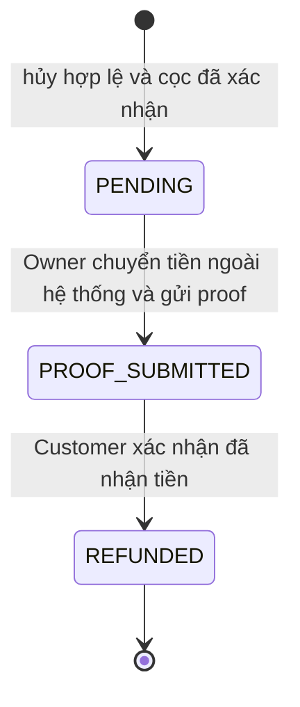

# Payment Specification

## Refund processing — implemented 2026-10-10

Customer hoặc Owner cancellation `CONFIRMED → CANCELLED` đủ điều kiện đều tạo Refund `PENDING` nguyên tử và state machine `PENDING → PROOF_SUBMITTED → REFUNDED` đã được triển khai. Owner cancellation chỉ áp dụng booking thuộc Facility mình, bắt buộc reason và không áp cutoff Customer; cả hai actor đều dùng đúng `deposit_amount` snapshot. Owner chuyển tiền ngoài hệ thống rồi gửi một proof; Customer tự kiểm tra tiền thực tế và xác nhận. Không reject/dispute/resubmit/replace/delete/auto-confirm và không đổi Booking khỏi `CANCELLED`.

API dùng `refund_id`: Owner `GET /owner/refunds/{refund_id}` và `POST /owner/refunds/{refund_id}/proof`; Customer `GET /refunds/{refund_id}` và `POST /refunds/{refund_id}/confirm`. Booking Detail Customer/Owner trả Refund summary để render cùng route hiện có; các GET Refund chỉ cấp signed proof URL sau ownership check. List Refund và Refund Center deferred.

Proof là JPEG/PNG tĩnh tối đa 5.000.000 byte và 25.000.000 decoded pixels, kiểm tra MIME, magic bytes và Sharp decode. Storage Cloudinary authenticated/private, URL ký TTL 300 giây; không expose internal identifier. Proof immutable sau commit. Upload ngoài transaction; transaction recheck actor/ownership/state và ghi `PROOF_SUBMITTED` bằng DB time. Customer confirm ghi `confirmed_at` và `refunded_at` cùng DB time. Mọi retry/unknown result phải đọc state authoritative trước khi gửi lại.

## Owner Bank Account + QR — implemented 2026-10-09

BankAccount hiện hành thuộc từng Facility. Owner GET/PUT ba trường text và POST/DELETE QR qua authenticated storage; DTO chỉ trả `has_qr_image`, private `qr_image_url` và `qr_image_expires_at`, tuyệt đối không trả raw path. QR JPEG/PNG được kiểm tra nội dung thật, giới hạn 5.000.000 byte/25.000.000 pixel và chuẩn hóa PNG. Signed URL TTL 300 giây.

Booking tiếp tục snapshot bank text và QR identifier khi tạo. Customer Booking Detail sinh URL/expiry từ snapshot; Booking cũ không đổi khi Owner replace/delete QR, Booking mới dùng QR hiện hành hoặc null. Replace/delete current pointer không destroy object cũ trong MVP; reconciliation orphan deferred. PaymentProof lifecycle, cọc 30% và remaining 70% không thay đổi.

## Customer Payment Phase C — implemented 2026-10-08

Customer UI đã hoàn thiện phần sau submit. Với `PENDING_CONFIRMATION`, route Payment tải proof bằng `GET /payments/bookings/{booking_id}/proof`, kiểm tra ownership qua backend và validate whitelist gồm `id`, `booking_id`, `status`, `submitted_at`, `proof_image_url`, `proof_image_expires_at`. `booking_id` phải khớp Booking đang xem, URL phải HTTPS và expiry phải sau server-time; frontend không nhận hoặc dựng `image_path`/storage identifier.

Ảnh proof cọc read-only, không replace/delete/resubmit; URL lỗi được refresh tự động tối đa một lần cho failure cycle, sau đó cần thao tác tải lại rõ ràng. PENDING_CONFIRMATION không countdown, không auto-expire và không Customer cancel. Focus refetch Booking chuyển presentation theo state authoritative. `CONFIRMED`, `REJECTED`, `EXPIRED`, `CANCELLED` đều có presentation riêng; Refund proof/confirmation đã triển khai trong Booking Detail, notification chưa triển khai.

## Customer Payment Phase B — implemented 2026-10-08

Frontend `PENDING_PAYMENT` đã triển khai đầy đủ theo reference approved trên route `/bookings/:booking_id/payment`: dữ liệu booking/bank/amount đều từ snapshot server, countdown dùng `expires_at` và `meta.server_time`, QR chỉ dùng URL an toàn từ DTO hoặc fallback khi `null`. Preview JPEG/PNG chỉ dùng object URL trong memory và được cleanup; frontend không upload trực tiếp tới Cloudinary.

POST proof giữ multipart một field `image`, chống double submit và unknown-result; kết quả thành công phải được xác nhận bằng GET Booking Detail trước khi chuyển sang trạng thái `PENDING_CONFIRMATION`. Customer cancel dùng endpoint Phase A, modal xác nhận và authoritative refetch; race 409 hoặc kết quả chưa rõ không được optimistic transition. Background GET khi focus giữ snapshot hợp lệ gần nhất, nhưng terminal/expired/error/unknown vẫn khóa submit. Phase C còn UI submitted/private proof chuyên biệt; không đổi payment state machine, schema hoặc API contract.

## Current implementation baseline — 2026-10-07

Customer PaymentProof upload, Customer GET proof riêng tư, Owner private review/confirm/reject và Refund lifecycle đã triển khai. GET proof chỉ cấp URL authenticated 300 giây sau kiểm tra ownership và không trả storage identifier. Payment Confirm giữ slot locks; Reject nhả locks. Refund Owner proof và Customer confirmation giữ Booking `CANCELLED`; notification và automated reconciliation vẫn DEFERRED.

## Payment Backend + Frontend Phase 1 — implemented, 2026-10-06

CURRENT — Backend/frontend Payment đã triển khai upload proof, Customer GET proof riêng tư, Owner review confirm/reject, Bank Account + QR snapshot delivery và Refund workflow. Customer confirmed cancellation tạo nghĩa vụ Refund PENDING; Owner gửi proof riêng tư, Customer xác nhận thành REFUNDED. Notification và scheduler vẫn deferred.

### Entry, ngân hàng và frontend

- Session hợp lệ, User ACTIVE, CUSTOMER capability (gồm Approved Owner); ngoài quyền hoặc booking không tồn tại cùng404. Guest dùng Auth foundation; không tự submit sau login.
- GET Booking Detail đã trả bank_name_snapshot/account_number_snapshot/account_holder_snapshot/deposit_amount cùng expires_at/meta.server_time; không đọc BankAccount hiện hành thay snapshot, không cần DTO/schema mới.
- Với Booking V1, nội dung chuyển khoản lịch sử vẫn là `BOOKING <booking_id>` do frontend derive từ ID thật. Booking V2 dùng `transfer_reference = CLDN <BOOKING_ID>` do backend derive và trả trong DTO; không cần cột mới. Không xác thực giao dịch ngân hàng tự động.
- QR: schema có qr_image_path_snapshot VARCHAR(1024) nullable, create snapshot nhưng DTO không expose path. Detail sinh signed URL TTL 300 giây; snapshot null hiển thị fallback “QR thanh toán chưa khả dụng. Vui lòng chuyển khoản bằng thông tin bên cạnh.”
- Chỉ PENDING_PAYMENT còn hạn được upload. Countdown = expires_at - meta.server_time - thời gian client trôi qua monotonic; reload không reset5 phút. Zero/focus GET Detail; background focus sync giữ snapshot đã xác minh gần nhất nên không tự khóa submit chỉ vì `busy`. Lỗi sync/unknown hoặc chưa có snapshot thì khóa submit; không tự EXPIRED.
- PENDING_CONFIRMATION quay về Detail, không countdown/auto-expire/Customer cancel. CONFIRMED/REJECTED/CANCELLED/EXPIRED/COMPLETED không upload, về Detail theo state thật. 404 không lộ dữ liệu.
- FormData chỉ image: API client không JSON.stringify, không tự Content-Type; giữ credentials include, Origin/CSRF và normalized error. Loading/error/expired/idle/selected/uploading/success/unknown tách biệt; nút “Tôi đã chuyển khoản” disabled khi chưa chọn ảnh, đang gửi hoặc chưa xác minh được state. Chặn double-submit, không auto retry POST.
- HTTP201 về Detail với “Chờ chủ sân xác nhận”, không CONFIRMED. Timeout/network/5xx/response mất: GET Detail để phục hồi; PENDING_CONFIRMATION = đã nhận; PENDING_PAYMENT còn hạn chỉ cho chủ động thử lại sau sync; terminal không retry; GET lỗi giữ unknown/khóa submit. PENDING_PAYMENT không chứng minh request trước đã dừng: backend vẫn serialize và UNIQUE chống duplicate.

### Storage và validation đã chốt

- Adapter Cloudinary riêng cho PaymentProof; không dùng adapter Facility public. Sử dụng delivery type authenticated để bảo vệ bản gốc và biến thể, resource_type=image; không public upload delivery.
- Identifier ngẫu nhiên do backend sinh, không filename/path của client, không overwrite; image_path chỉ lưu identifier cần thiết, không signed URL. MIME/size lưu từ file đã kiểm tra.
- GET `/api/v1/payments/bookings/:booking_id/proof` đã triển khai cho Customer sở hữu booking. Backend cấp URL authenticated có hạn đúng 300 giây bằng cùng storage adapter với Owner; không trả `image_path`, không log URL ký/nội dung ảnh/credential. Không có proof và cross-customer đều 404.
- Chỉ image/jpeg và image/png, tối đa5,000,000bytes, width × height <=25,000,000pixels, ảnh tĩnh một frame. Validate đúng multipart field, một file/không text field, size, MIME đối chiếu magic bytes, decode thật với pixel limit trước giải nén đầy đủ; từ chối malformed/multi-frame. Không tin extension/filename/client MIME. WebP/SVG không được nhận.
- Upload/storage network ngoài DB transaction. Cleanup best-effort ngoài transaction; lỗi log mã an toàn và identifier để xử lý thủ công, không che lỗi gốc. COMMIT chưa rõ phải xác minh DB reference trước destroy; chưa xác minh được thì giữ object, không xóa mù. Không scheduler/reconciliation Phase1. Không xóa object được tham chiếu hoặc proof lịch sử.

### Transaction, race và trạng thái liên quan

Precheck session/CUSTOMER/ownership/state trước upload để tránh upload ngoài quyền. Sau storage thành công: transaction khóa User IDs tăng dần/deduplicate (Customer và Owner) → Facility → Court → Booking → PaymentProof nếu đã tồn tại → slot locks nếu expiry cần nhả. Recheck session/User ACTIVE/ownership/quan hệ sau khóa; lấy DB clock_timestamp, không lấy thời gian frontend hoặc lúc bắt đầu upload.

Booking hợp lệ còn PENDING_PAYMENT và now < expires_at vẫn được nhận proof khi Facility chuyển SUSPENDED, Court chuyển INACTIVE hoặc Owner User LOCKED. Không tái áp điều kiện tạo Booking mới; Customer vẫn phải ACTIVE, kể cả Customer đồng thời là Owner của chính sân. Không có enum Facility/Court LOCKED mới.

Trong transaction: một PaymentProof SUBMITTED với submitted_at theo DB time + Booking PENDING_CONFIRMATION, giữ expires_at cũ và toàn bộ CourtSlotLock. Không gia hạn/tạo slot mới; chỉ commit xong mới201. Một booking tối đa một proof được nhận; duplicate409 PROOF_ALREADY_SUBMITTED, không overwrite/resubmit. BOOKING_EXPIRED ưu tiên cho booking EXPIRED hoặc PENDING_PAYMENT đến hạn; state khác không hợp lệ409 INVALID_BOOKING_STATE.

Upload bắt đầu trước hạn nhưng recheck sau hạn vẫn từ chối. Nếu phát hiện PENDING_PAYMENT hết hạn, commit EXPIRED/expired_at và nhả locks trước khi trả409 BOOKING_EXPIRED; không throw làm rollback chính expiry. Giữ BookingSlot/history. Nếu expiry/create khác đã thắng khóa thì không nhận proof; nếu proof thắng thì PENDING_CONFIRMATION không bị expiry. Storage failure không chuyển state; DB failure rollback proof/state, cleanup theo quy tắc COMMIT ở trên.

### Source review và kế hoạch implementation, chưa tạo/sửa source

| File/module | Công việc cần làm |
| --- | --- |
| backend/src/modules/payments/routes.js | Tạo POST proof, auth/CUSTOMER/Origin/CSRF, multipart limits, whitelist DTO/error |
| backend/src/modules/payments/service.js | Tạo precheck/upload/transaction/cleanup, duplicate/expiry/unknown commit |
| backend/src/modules/payments/validation.js | Tạo signature/decode/bytes/pixels/frame validation; file-type hiện có chưa đủ decode |
| backend/src/modules/payments/storage.js | Tạo adapter Cloudinary authenticated riêng, random identifier, destroy an toàn; GET delivery deferred |
| backend/src/modules/bookings/service.js và helper transaction nếu tách | Tái sử dụng/tách lockCourt, actorCheck, expire đang private; giữ nguyên lock order/behavior create/list/detail |
| backend/src/app.js | Đăng ký module Payment/inject adapter phục vụ tests |
| backend/package.json và lockfile | Chỉ cân nhắc image decoder cần thiết khi implementation; chưa cài trong task spec |
| backend/test/payment*.test.js, payment.integration.js | Local/storage fake/DB fixture rollback, race/cleanup/security; regression Booking/Auth/modules đã có |
| frontend/src/services/api.js | Hỗ trợ FormData, giữ JSON flows/Auth/error contract cũ |
| frontend/src/routes/AppRoutes.jsx; features/bookings/BookingDetail.jsx | Route Payment và entry; dùng chung logic countdown/read/auth |
| frontend/src/features/payments/ và frontend/test/ | UI theo PNG, upload/unknown recovery, tests + regression |

Không cần thay Prisma/schema/migration, Auth architecture, BankAccount hoặc Booking DTO. Auth middleware hiện tại tái sử dụng; chặn unauthorized trước parser/provider. Multipart byte/file/field limits và decode pixel/frame limits bắt buộc; không thêm ngưỡng rate-limit nghiệp vụ tùy ý. Rate/abuse vận hành bổ sung theo deployment, không được thay authorization hoặc UNIQUE bằng rate limit.

Kiểm chứng implementation phải bao phủ MIME giả/ảnh hỏng/đa frame/biên size-pixel, cross-customer404, session/CSRF/Origin, status mutation sau booking, upload-vs-expiry/duplicate, COMMIT unknown/reference check, storage/cleanup lỗi, giữ locks, frontend FormData/countdown/unknown/reload và regression. Không gọi storage/DB thật trong task specification.

Booking Phase 1 (spec chốt 2026-10-03) chỉ tạo PENDING_PAYMENT, list/detail cá nhân và lazy expiry; Payment phase sau nhận proof trước expires_at. QR identifier vẫn chỉ giữ nội bộ; DTO hiện sinh signed URL/expiry từ snapshot mà không trả path.

BankAccount text GET/PUT và QR POST/DELETE Owner thuộc Booking Configuration, xem [BOOKING_CONFIGURATION_SPEC.md](BOOKING_CONFIGURATION_SPEC.md). Singleton upsert text giữ QR hiện hành; client không PUT raw path. Thay bank/QR hiện hành không sửa snapshot Booking cũ.

Baseline v1: Customer capability áp dụng cho cả Approved Owner khi dùng chức năng cá nhân; quyền quản lý Owner chỉ áp dụng tài nguyên cơ sở mình. PENDING_CONFIRMATION không countdown 5 phút, không tự expire, không cho Customer cancel; Owner phải Confirm hoặc Reject.

## Phạm vi và nguồn chuẩn

Tuân [PROJECT_OVERVIEW.md](../PROJECT_OVERVIEW.md), đặc biệt BR-PAY-01..09, BR-CANCEL-01..06, BR-REFUND-01..06, và [BOOKING_SPEC.md](BOOKING_SPEC.md). Quy tắc chính thức cập nhật ngày 2026-09-19: cọc 30%, 70% thanh toán tại sân, hủy hợp lệ và theo dõi hoàn cọc thủ công.

Không payment gateway, không đọc giao dịch ngân hàng tự động, không automated refund. Website quản lý số tiền snapshot, trạng thái và chứng từ; chuyển cọc/hoàn cọc đều do hai bên thực hiện ngoài website.

## Deposit cố định 30%

`DEPOSIT_RATE = 30%` là hằng số nghiệp vụ toàn hệ thống. Owner không lựa chọn kiểu cọc, không chỉnh tỷ lệ hoặc số tiền cọc. Không cần bảng cấu hình cọc theo Facility.

Backend tính theo thứ tự:

1. total_amount từ các PriceRule/BookingSlot; không tin frontend.
2. deposit_amount = total_amount * 30 / 100.
3. remaining_amount = total_amount - deposit_amount, là phần 70% thanh toán tại sân.

Dùng decimal. Giữ quy ước VND: tổng và cọc làm tròn từng bước một lần đến VND gần nhất, nửa đơn vị lên; phần còn lại dùng phép trừ để tổng khớp, không làm tròn độc lập. Lưu total_amount, deposit_amount, remaining_amount snapshot trong Booking. Không nhận các số tiền cuối cùng hoặc tỷ lệ cọc từ client.

| Thành phần | Ví dụ |
| --- | --- |
| Tổng tiền sân | 200.000đ |
| Cọc trước 30% | 60.000đ |
| Thanh toán tại sân 70% | 140.000đ |

## Thanh toán 70% tại sân

Customer trả trực tiếp cho Owner bằng tiền mặt hoặc chuyển khoản khi đến sân. Website không thu khoản này, không tạo giao dịch, không yêu cầu proof và không có API duyệt thanh toán 70%.

Sau khi sử dụng sân và hai bên xử lý khoản còn lại, Owner đánh dấu Booking COMPLETED (từ CONFIRMED, sau end_at). MVP không thêm remaining_payment_status; hành động hoàn thành ghi nhận hai bên đã xử lý trực tiếp, không phải xác thực ngân hàng tự động. Review chỉ sau COMPLETED.

## Bank Account và QR

Một bank_accounts hiện hành mỗi Facility: bank_name, account_number, account_holder, qr_image_path tùy chọn. Account number là chuỗi. Owner chỉ sửa ngân hàng cơ sở mình. Booking snapshot thông tin ngân hàng/QR để đổi cấu hình sau không đổi chỉ dẫn booking cũ.

Thông tin chuyển cọc chỉ trả cho Customer sở hữu booking và Owner liên quan, không public đầy đủ trên danh sách cơ sở. QR là ảnh hỗ trợ chuyển khoản, không có callback payment. File QR còn được snapshot tham chiếu không xóa vật lý.

Nội dung chuyển khoản V1 tương thích là `BOOKING <booking_id>` do frontend derive từ ID thật. Với V2, backend trả `CLDN <BOOKING_ID>` trong DTO. Ngân hàng Facility là tài khoản nhận cọc của Owner, không phải tài khoản Customer nhận refund; cách trao đổi thông tin nhận refund chưa được đặc tả, không tự thêm schema ngân hàng Customer.

## Payment Instructions

Checkout/Payment hiển thị rõ tổng, cọc 30%, trả tại sân 70%, bank/QR snapshot, ngày/giờ/cơ sở/sân, expires_at và server_time. QR snapshot delivery riêng tư đã triển khai; khi snapshot null UI dùng fallback trung tính. Nội dung bắt buộc:

> Bạn chỉ cần thanh toán 30% tiền cọc để xác nhận đặt sân. 70% còn lại thanh toán trực tiếp tại sân.

Ghi thêm rằng Owner cần kiểm tra và xác nhận proof. Upload ảnh không đồng nghĩa đặt sân đã CONFIRMED hoặc đã trả đủ 100%.

## Payment Proof — chỉ cọc 30%

- Customer → Owner; không dùng cho 70% và không dùng cho refund.
- Một booking tối đa một PaymentProof nhận thành công; payment_proofs.booking_id UNIQUE.
- `POST /api/v1/payments/bookings/{booking_id}/proof`, multipart image, không nhận URL tùy ý.
- Customer ACTIVE phải sở hữu booking; booking PENDING_PAYMENT và DB now < expires_at sau khi lấy khóa.
- Chỉ JPEG/PNG ≤5,000,000bytes, <=25,000,000pixels, ảnh tĩnh một frame; kiểm tra MIME/signature/decode thực. Không WebP/SVG/file thực thi.
- File Cloudinary authenticated riêng tư ngoài PostgreSQL; DB lưu identifier/mime_type/size_bytes; chức năng đọc/URL có hạn5phút sau authorization hoãn sang phase sau.
- Upload file ngoài transaction; sau đó kiểm tra lại state/hạn, ghi proof SUBMITTED và chuyển booking PENDING_CONFIRMATION nguyên tử. File không được DB tham chiếu được dọn riêng.

Proof status: `SUBMITTED → APPROVED` hoặc `SUBMITTED → REJECTED`. Không thêm status cho payment 70%. PENDING_CONFIRMATION có proof SUBMITTED không được Customer cancel, không tự expire; Owner phải Confirm/Reject.

## Relationship với 5-minute Hold

5 phút **chỉ áp dụng PENDING_PAYMENT**, tính từ created_at, không refresh/gia hạn khi upload đang chạy. DB now >= expires_at → EXPIRED và nhả slot. File đã tải nhưng chưa được server chấp nhận trong transaction trước hạn không được coi là gửi proof thành công.

Gửi hợp lệ trước hạn → PENDING_CONFIRMATION. Trạng thái này không expiry theo countdown 5 phút; expires_at cũ vẫn lưu làm lịch sử. Owner có thể kiểm tra sau đó. TODO quy trình Owner chậm phản hồi; không tự thêm timeout.

## Owner Confirmation và Rejection

Owner xem booking, Customer/name/phone, Facility/Court/ngày/giờ, total, deposit 30%, remaining 70%, proof và trạng thái cọc. Chỉ tài nguyên cơ sở mình; Admin không duyệt thay Owner.

Confirm kiểm tra Booking PENDING_CONFIRMATION, Proof SUBMITTED; chuyển proof APPROVED, lưu reviewed_by/reviewed_at; booking CONFIRMED/confirmed_at. Giữ slot; notification Customer khi module đã triển khai.

Reject nhận body duy nhất `reason`, trim và bắt buộc dài 1–500 ký tự Unicode, map sang rejection_reason. Cùng transaction: proof REJECTED, reviewed_by/reviewed_at/rejection_reason; booking REJECTED/rejected_at và cùng lý do; xóa court_slot_locks; giữ BookingSlot/PaymentProof lịch sử. Không tạo Refund vì cọc chưa được xác nhận nhận tiền. Notification Customer chỉ thực hiện khi module notification được triển khai và không phải điều kiện commit.

Owner Booking + Payment Review dùng các endpoint và DTO tại [OWNER_BOOKING_PAYMENT_SPEC.md](OWNER_BOOKING_PAYMENT_SPEC.md). Proof authenticated chỉ được cấp sau authorization dưới hai field `proof_image_url` và `proof_image_expires_at`, TTL đúng 300 giây; không trả identifier lưu trong `image_path`.

## Không resubmit booking REJECTED

REJECTED là kết thúc: nhả slot, không upload lại proof cho booking cũ, không chuyển REJECTED → PENDING_CONFIRMATION. Muốn đặt lại phải tạo booking mới, kiểm tra lại availability/giá, cọc 30% và hold 5 phút mới. Proof cũ giữ lịch sử; không tự chuyển khoản cọc cũ sang booking mới.

Nếu thực tế đã chuyển tiền nhưng proof chưa được duyệt/bị reject/booking expired, hai bên đối soát ngoài hệ thống. Không coi ảnh chưa duyệt là khoản đã được Owner xác nhận để tự tạo Refund.

## Cancellation và điều kiện Refund

| Trường hợp | Booking / kết quả | Refund |
| --- | --- | --- |
| Customer hủy PENDING_PAYMENT còn hạn | CANCELLED, không xét cutoff, nhả slot | Không: chưa xác nhận cọc |
| Customer yêu cầu hủy PENDING_CONFIRMATION | Từ chối, giữ nguyên state và slot; Owner phải Confirm/Reject | Không tạo refund |
| Customer hủy CONFIRMED với now < start_at - cutoff_hours snapshot | CANCELLED, nhả slot | PENDING, amount = 100% deposit_amount |
| Customer hủy CONFIRMED đúng/quá cutoff | Từ chối, không đổi booking | Không tạo refund |
| Owner hủy CONFIRMED có lý do | CANCELLED, nhả slot; không áp cutoff Customer | PENDING, amount = 100% deposit_amount |
| Booking COMPLETED/REJECTED/EXPIRED/CANCELLED | Không được hủy | Không tạo thêm refund |

cutoff_hours=2, start 18:00: trước 16:00 được Customer hủy; đúng 16:00 không được. cancelled_by là CUSTOMER/OWNER theo ngữ cảnh route đã xác thực (Owner dùng Customer route cho booking cá nhân vẫn là CUSTOMER), không phải Booking status mới. Owner hủy bắt buộc lý do; Customer có thể nhập lý do.

Refund chỉ cho cọc được xác nhận qua PaymentProof APPROVED. Ví dụ deposit_amount=60.000 thì refund.amount=60.000, không 200.000 và không 140.000. CONFIRMED thiếu proof APPROVED là lỗi dữ liệu, rollback thay vì bỏ refund. TODO fallback nếu CONFIRMED thiếu cutoff snapshot; Customer nhánh đó nhận CANCELLATION_POLICY_NOT_CONFIGURED, các nhánh khác vẫn theo ma trận.

## Refund Flow riêng

1. Transaction hủy tạo tối đa một Refund PENDING cùng lúc đổi Booking CANCELLED, metadata và nhả slot. Không có endpoint tạo refund tùy ý. UNIQUE booking_id ngăn bản ghi trùng.
2. Owner chuyển 100% cọc cho Customer ngoài website. Hành động mạng/ngân hàng không nằm trong DB transaction.
3. Owner upload minh chứng hoàn cọc qua `POST /api/v1/owner/refunds/{refund_id}/proof`. PENDING → PROOF_SUBMITTED; lưu proof_image_path, proof_submitted_at và metadata upload.
4. Customer đọc refund/proof của booking mình, tự kiểm tra thực tế đã nhận tiền, gọi `POST /api/v1/refunds/{refund_id}/confirm` → REFUNDED.
5. confirmed_at và refunded_at được ghi bằng DB time khi Customer xác nhận; refunded_at là thời điểm hệ thống ghi nhận hoàn tiền hoàn tất, không phải timestamp giao dịch ngân hàng được tự xác minh.

Booking vẫn CANCELLED ở mọi bước. Refund PENDING nghĩa còn phải hoàn, PROOF_SUBMITTED nghĩa Owner đã gửi ảnh chờ Customer xác nhận; chưa có nghĩa tiền chắc chắn đã nhận. REFUNDED không bao giờ thuộc BookingStatus. Không timeout 5 phút hoặc auto-confirm cho Refund.

## Refund Proof và lưu lịch sử

Refund proof là Owner → Customer, lưu trực tiếp ở refunds trong MVP, tách payment_proofs. Một ảnh nhận thành công trong luồng PENDING → PROOF_SUBMITTED; chưa có sửa/thay ảnh, reject hoặc resubmit refund proof. TODO xử lý ảnh sai/tranh chấp/Customer không phản hồi; không tự phát minh nhánh state mới.

Refund nằm ngoài Payment Phase1. Đề xuất validation Refund cũ (JPEG/PNG/WebP ≤5 MiB, pixel cap TODO) chưa được quyết định mới cho proof cọc phê duyệt thay thế; phải review riêng trước implementation Refund, không dùng làm contract upload PaymentProof. File refund riêng tư, URL xem có thời hạn. Chỉ Owner sở hữu upload; chỉ Customer sở hữu xác nhận; cả hai được xem dữ liệu liên quan. Admin không upload/xác nhận thay các bên.

Lưu reason, requested_at, proof_submitted_at, refunded_at, confirmed_at, created_at, updated_at; không sửa amount, không xóa booking/payment/refund đã có lịch sử. Các mốc đủ lưu lịch sử luồng tuyến tính MVP, chưa cần event log riêng.

## Transaction / Retry / Security

Khóa cùng thứ tự User (ID tăng dần, loại trùng) → Facility → Court → Booking → PaymentProof → Refund → slot locks, bỏ qua hàng không liên quan. Refund submit/confirm kiểm tra Booking CANCELLED, amount bằng deposit snapshot, cọc APPROVED, ownership và Refund state sau khi khóa.

Cancellation và tạo Refund phải commit/rollback cùng nhau; không nhả slot mà làm mất nghĩa vụ hoàn cọc. Upload proof ngoài transaction rồi kiểm tra lại trước ghi; orphan file được dọn. Submit/confirm lặp trả 409 INVALID_REFUND_STATE, không nhân bản/xóa lịch sử hoặc tự chuyển tiền. Customer không thể confirm khi Refund còn PENDING.

Lỗi chính: INVALID_BOOKING_STATE, BOOKING_EXPIRED, CANCELLATION_NOT_ALLOWED, CANCELLATION_POLICY_NOT_CONFIGURED, CANCELLATION_REASON_REQUIRED, INCONSISTENT_PAYMENT_STATE, INVALID_REFUND_STATE, RESOURCE_NOT_FOUND, PROOF_TOO_LARGE, INVALID_FILE_TYPE, INVALID_IMAGE. API_SPEC quy định HTTP tương ứng.

Backend không tin amount/status/actor do client gửi; không public bucket proof, không log ảnh hoặc credential. Website không thực hiện chuyển cọc, chuyển 70% hoặc chuyển hoàn tiền tự động.

## Booking V2 compatibility boundary (2026-10-15)
PaymentProof upload/read/review và Refund hiện hành tiếp tục phục vụ Booking V1. Booking V2 Phase 1 không upload proof và payment route chỉ hiển thị read-only, không gọi proof API. Owner V1 confirm/reject giữ nguyên. Owner confirm/reject V2, chuyển khoản sau xác nhận và refund V2 chưa thuộc Phase 1; các đường mutation này phải fail closed cho đến khi contract phase sau được duyệt.
### Phase 2 — Customer bank transfer instructions

V2 `PENDING_CONFIRMATION` hiển thị bank/QR snapshot, tổng/cọc/còn lại, `CLDN <BOOKING_ID>` và deadline 30 phút từ Booking Detail; không có file picker hoặc PaymentProof request. V2 `EXPIRED` và `CONFIRMED` có presentation read-only riêng. POST proof phải trả conflict `PAYMENT_PROOF_NOT_ALLOWED_FOR_BOOKING_FLOW` cho V2 trước storage upload và không đổi Booking, PaymentProof hay CourtSlotLock. PaymentProof V1, signed URL, duplicate-submit và unknown-result recovery giữ nguyên. Owner V2 confirmation vẫn deferred sang phase tiếp theo.

## Booking V2 Phase 3 compatibility — 2026-10-16
Owner xác nhận Booking V2 trực tiếp theo booking ID sau khi tự đối chiếu giao dịch ngân hàng; V2 không tạo/đọc/duyệt PaymentProof. Hai endpoint V2 branch bằng `booking_flow_version`; endpoint PaymentProof V1 và Refund V1 giữ nguyên. Không bank API, payment gateway hoặc tự động xác nhận.
